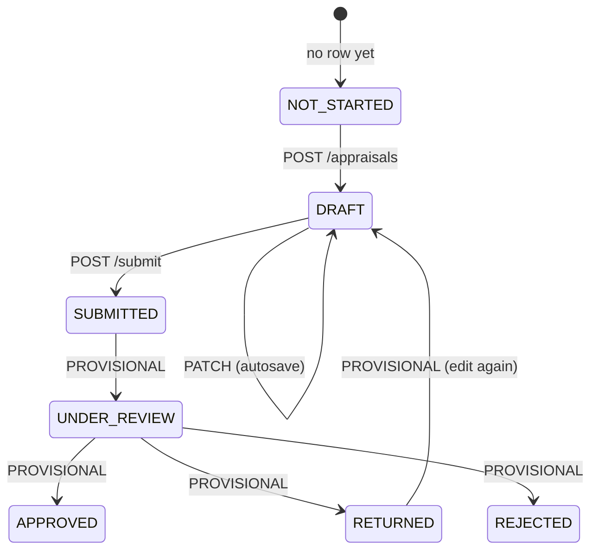

# API Contract

> **PROPOSED — REQUIRES BACKEND IMPLEMENTATION.** Nothing in this document exists as a running service yet. It is the contract the approved frontend already speaks (through a mock), frozen so the backend can be built against it.

| | |
|---|---|
| Structure authority | The Sri Vasavi *Faculty Self-Appraisal & Assessment Report* PDF |
| Wire types in code | [`frontend/src/contract/dto.ts`](../../frontend/src/contract/dto.ts) |
| UI form ↔ wire conversion | [`frontend/src/contract/mapper.ts`](../../frontend/src/contract/mapper.ts), driven by `src/data/appraisalSchema.ts` |
| Mock implementation | [`frontend/src/lib/mockAdapter.ts`](../../frontend/src/lib/mockAdapter.ts) (stores and returns exactly these DTOs) |
| Related | [domain-model.md](domain-model.md) · [service-boundaries.md](service-boundaries.md) · [database-design.md](database-design.md) · [../ui/pdf-audit.md](../ui/pdf-audit.md) |

The 16 UI steps are a **user-interface workflow**, not 16 resources. The API is organised by the PDF's business structure (below).

Verified in the frontend: converting a fully populated form to this wire shape and back is lossless (27 blocks, 136 fields, matrix, flags), and every property name and enum code in the UI matches `dto.ts` (27 object checks, 24 enum checks, 0 failures).

---

## 1. Conventions

| Topic | Rule |
|---|---|
| Base path | `/api/v1` behind the API Gateway |
| Format | JSON, `Content-Type: application/json` (uploads: `multipart/form-data`) |
| Property names | `camelCase` |
| Enums | `UPPER_SNAKE_CASE` codes. PDF wording lives in the frontend labels |
| Dates | `YYYY-MM-DD`. Month-year fields: `YYYY-MM`. Timestamps: ISO-8601 UTC |
| Ids | UUID. **Repeating rows carry a client-generated UUID `id`**, kept stable across saves |
| Empty values | Absent optional scalars are sent as `null` (never `""`). Empty repeating sections are `[]` |
| Numbers | JSON numbers. Percentages 0–100. Money in rupees (`…Rs`) |
| Auth | `Authorization: Bearer <JWT>`. Roles: `FACULTY`, `HOD`, `PRINCIPAL` (an `ADMIN` role is PROVISIONAL) |
| Errors | RFC 7807 `application/problem+json`: `{ type?, title, status, detail?, errors?: [{ path, message }] }` |
| Concurrency | `AppraisalDto.version` (also `ETag`). Writes send `If-Match: <version>`. Stale → `412` |
| Replace semantics | A section sent in `PATCH` replaces that section wholesale. Arrays are replaced as a whole: rows are upserted by `id`, rows missing from the array are deleted |
| Idempotency | Section replace is idempotent. `POST /appraisals` is unique per (faculty, academic year) |

### Provenance legend

| Tag | Meaning |
|---|---|
| **[P]** | Comes from the Faculty Profile (institutional record) |
| **[P→A]** | Prefilled from the profile when the appraisal is created, then a **snapshot owned by the appraisal** (the cadre in 2025-26 must not change when the profile changes later) |
| **[A]** | Entered by the faculty on the appraisal |
| **[S]** | Produced by backend scoring. Read-only for the frontend |
| **[R]** | Entered by the HoD / Principal. Read-only for the faculty frontend |

### Status legend

| Tag | Meaning |
|---|---|
| **PDF** | Defined by the college PDF |
| **PROVISIONAL** | Not defined by the PDF; requires college confirmation. Shown in the UI as an amber "Provisional" tag. See [§9](#9-provisional-register) |
| **UI rule** | Frontend-only input rule (e.g. "required"). Not an institutional rule. The backend must re-validate but should not treat these as business rules until the college confirms them |

---

## 2. Enumerations

All are closed sets taken from the PDF unless marked.

| Enum | Codes → PDF wording |
|---|---|
| `AppraisalStatus` | `NOT_STARTED` (no appraisal row exists), `DRAFT`, `SUBMITTED`; **PROVISIONAL:** `UNDER_REVIEW`, `APPROVED`, `RETURNED`, `REJECTED` |
| `CadreCode` | `LECTURER` Lecturer · `ASSISTANT_PROFESSOR` · `SENIOR_ASSISTANT_PROFESSOR` · `ASSOCIATE_PROFESSOR` · `PROFESSOR` |
| `DepartmentCode` | `CE` · `ME` · `ECE_ECT` "ECE / ECT" · `EEE` · `CSE_IT` "CSE / IT" · `AIML_CAI_DS` "AIML / CAI / DS" · `BSH` · `MBA` |
| `PhdStatus` | `AWARDED` · `PURSUING` · `NOT_APPLICABLE` |
| `Level` | `INST` Inst · `STATE` State · `NAT` Nat · `INTL` Intl |
| `ConferenceLevel` | `NAT` · `INTL` |
| `ProjectLevel` | `DIPLOMA` · `UG` · `PG` |
| `ProjectOutcome` | `PAPER` · `PATENT` · `PROTOTYPE` · `COMPETITION` |
| `ProgramMode` | `OFFLINE` · `ONLINE` · `BLENDED` |
| `CertificationPlatform` | `NPTEL` · `SWAYAM` · `COURSERA` · `OTHER` |
| `JournalIndexing` | `SCI` · `SCOPUS` · `UGC_CARE` · `ABDC` · `OTHERS` |
| `ResearchPlatform` | `GOOGLE_SCHOLAR` · `SCOPUS` · `WEB_OF_SCIENCE` |
| `GuidanceDegree` | `PHD` Ph.D. · `MTECH` M.Tech · `MBA` |
| `GuidanceStatus` | `REGISTERED` · `SUBMITTED` · `AWARDED` |
| `PhdStage` | `COURSE_WORK` · `COMPREHENSIVE_PROPOSAL` · `SYNOPSIS_PRE_PHD` · `THESIS_SUBMITTED` · `VIVA_VOCE_COMPLETED` |
| `FundedProjectType` | `RESEARCH` · `CONSULTANCY` |
| `FundedProjectStatus` | `SANCTIONED` · `APPLIED` |
| `IprType` | `DESIGN` · `UTILITY` · `COPYRIGHT` |
| `IprStatus` | `FILED` · `PUBLISHED` · `GRANTED` |
| `BookType` | `BOOK` · `CHAPTER` |
| `CriterionCode` | `TEACHING_LEARNING` 1 · `STUDENT_MENTORING` 2 · `FDP_CERTIFICATIONS` 3 · `ADMINISTRATIVE` 4 · `RESEARCH_PUBLICATIONS` 5 · `FUNDED_PROJECTS` 6 · `PATENTS_BOOKS_IPR` 7 · `OUTREACH` 8 · `MEMBERSHIPS_AWARDS` 9. **Exactly nine. There is no tenth: "Any Other Contributions" is not scored** |
| `SupportingDocumentType` | `COURSE_FILES_RESULT_ANALYSIS` · `STUDENT_FEEDBACK_REPORTS` · `MENTORING_RECORDS` · `PUBLICATION_PROOFS` · `PROJECT_SANCTION_LETTERS` · `PATENT_BOOK_PROOFS` · `FDP_COURSE_CERTIFICATES` · `ROLE_APPOINTMENT_ORDERS` · `EVENT_REPORTS` · `AWARDS_MEMBERSHIP_PROOFS` · `OTHERS` |

Free text with *suggested* values (not enums): student-achievement `achievement` (Placement / Hackathon / Paper / Award / GATE-CAT-GRE / Start-up), administrative `role` examples, outreach `role` (the PDF's 11 roles, last is "Others").

---

## 3. Scoring reference (Annexure A)

**Maximum marks only. The PDF defines no formula for converting activity into a self-score, so none is specified or implemented.** The backend is the source of truth for `maxScore` and `selfScore`; the frontend only displays them. The frontend also keeps this table as printed reference (Annexure A screen, and the maximum marks shown before a score sheet exists). Verified against the rendered PDF page: 45 values, 0 mismatches.

| # | Criterion (`CriterionCode`) | Lecturer | Asst. Prof. | Sr. Asst. Prof. | Assoc. Prof. | Professor |
|---|---|---:|---:|---:|---:|---:|
| 1 | Teaching & Learning (`TEACHING_LEARNING`) | 40 | 30 | 25 | 20 | 15 |
| 2 | Student Mentoring, Guidance & Achievements (`STUDENT_MENTORING`) | 15 | 12 | 10 | 8 | 5 |
| 3 | FDPs / Certifications (`FDP_CERTIFICATIONS`) | 15 | 10 | 8 | 5 | 5 |
| 4 | Administrative, Curriculum & Quality Contributions (`ADMINISTRATIVE`) | 15 | 15 | 15 | 15 | 20 |
| 5 | Research & Publications (`RESEARCH_PUBLICATIONS`) | 5 | 15 | 20 | 25 | 25 |
| 6 | Funded Projects / Consultancy (`FUNDED_PROJECTS`) | 0 | 5 | 7 | 10 | 12 |
| 7 | Patents, Books & IPR (`PATENTS_BOOKS_IPR`) | 0 | 3 | 5 | 7 | 8 |
| 8 | Outreach (`OUTREACH`) | 5 | 5 | 5 | 5 | 5 |
| 9 | Professional Memberships, Awards & Recognitions (`MEMBERSHIPS_AWARDS`) | 5 | 5 | 5 | 5 | 5 |
| | **Total** | **100** | **100** | **100** | **100** | **100** |

Backend responsibility: store this as reference data (see database-design.md), copy the cadre's maxima onto the appraisal's score rows when a score sheet is produced (so later changes to the annexure do not rewrite history), and keep each cadre summing to 100.

---

## 4. Resources and fields

Column key: **Req** = required by a *UI rule* (PROVISIONAL, §9 item 1). **Frontend validation** = what the UI enforces today. **Backend** = what the service must do (always re-validate; never trust the client).

### 4.1 Faculty profile: `FacultyProfileDto` (single) · Faculty Service · [P]

| Field | Type | Req | Notes |
|---|---|---|---|
| `id` | uuid | n/a | |
| `employeeId` | string \| null | | PDF "Employee ID" |
| `name` | string | yes | PDF "Name of the Faculty" |
| `email` | string \| null | | PDF "E-mail ID" |
| `contactNo` | string \| null | | PDF "Contact No." |
| `department` | `{ code: DepartmentCode, label }` \| null | | PDF "Department / Branch". `label` is the PDF abbreviation; a full name is PROVISIONAL |
| `cadre` | `CadreCode` \| null | | PDF "Designation (Cadre)" |
| `avatarUrl` | string \| null | | UI only, not in the PDF |

Frontend validation: none (display only). Backend: source of truth; resolved from the authenticated user.
Not in the profile DTO today but part of Part A (so also candidates for the profile once HR data exists): `highestQualification`, `phdStatus`, joining dates, experience, `researcherIds`. They are prefilled into the appraisal when available.

### 4.2 Academic year: `AcademicYearDto` · Appraisal Service

| Field | Type | Notes |
|---|---|---|
| `label` | string `YYYY-YY` | e.g. `2025-26`. **The list of years is PROVISIONAL** |
| `current` | boolean | which year the UI selects by default. PROVISIONAL |

### 4.3 Appraisal envelope: `AppraisalDto` · Appraisal Service · belongs to **faculty + academic year** (unique)

| Field | Type | Source | Notes |
|---|---|---|---|
| `id` | uuid | server | |
| `facultyId` | uuid | server | from the authenticated user |
| `academicYear` | string | server | fixed at creation |
| `status` | `AppraisalStatus` | server | `DRAFT` on creation; `NOT_STARTED` is never stored |
| `version` | integer | server | optimistic lock, starts at 1, +1 on every write |
| `createdAt`, `updatedAt` | timestamp | server | |
| `submittedAt` | timestamp \| null | server | |
| *section content* | see 4.4 to 4.16 | [A] | |
| `scoreSheet` | `ScoreSheetDto` \| null | [S] | read-only; ignored if sent |
| `reviews` | `{ hod, principal }` | [R] | read-only; ignored if sent |

`AppraisalSummaryDto` (list): `id, academicYear, status, createdAt, updatedAt, submittedAt, progress`. `progress = { completedSections, totalSections } | null` is **PROVISIONAL**: it depends on the provisional completeness rules; the UI can compute it itself from the full appraisal, so the backend may return `null`.

### 4.3a Section keys (what `PATCH` and `PUT …/sections/{section}` address)

`generalInfo`, `teaching`, `mentoring`, `fdp`, `administrative`, `research`, `fundedProjects`, `ipr`, `outreach`, `membershipsAwards`, `otherContributions`, `supportingDocuments`, `declaration`, `nothingToReport`.

| PDF part | Section key |
|---|---|
| Part A | `generalInfo` |
| Part B 1 | `teaching` |
| Part B 2 | `mentoring` |
| Part B 3 | `fdp` |
| Part B 4 | `administrative` |
| Part B 5 | `research` |
| Part B 6 | `fundedProjects` |
| Part B 7 | `ipr` |
| Part B 8 | `outreach` |
| Part B 9 | `membershipsAwards` |
| Part B 10 | `otherContributions` |
| Part B 11 (checklist ticks) | `supportingDocuments` |
| Declaration | `declaration` |
| Part B 11 (score sheet), HoD, Principal | read-only members `scoreSheet`, `reviews` |
| *UI feature, PROVISIONAL* | `nothingToReport` |

### 4.4 `generalInfo` (Part A) · single object · [P→A]

| Field | Type | Req | Frontend validation | Backend | PDF label |
|---|---|---|---|---|---|
| `facultyName` | string ≤200 | yes | non-empty | required | Name of the Faculty |
| `academicYear` | string | yes | **read-only** (shown, not editable) | set from the appraisal; ignore on write | Academic Year |
| `employeeId` | string ≤50 \| null | | | | Employee ID |
| `contactNo` | string ≤30 \| null | | | | Contact No. |
| `departmentCode` | `DepartmentCode` \| null | yes | select of 8 | enum check | Department / Branch |
| `cadre` | `CadreCode` \| null | yes | select of 5 | enum check; drives maximum marks | Designation (Cadre) |
| `highestQualification` | string ≤300 \| null | | | | Highest Qualification & Specialization |
| `phdStatus` | `PhdStatus` \| null | | select | enum check | Ph.D. Status |
| `dateOfJoiningInstitution` | date \| null | | date input | valid date | Date of Joining (Institution) |
| `dateOfJoiningPresentDesignation` | date \| null | | date input | valid date | Date of Joining (Present Designation) |
| `experienceTeachingYears` | number ≥0 \| null | | min 0, step 0.1 | ≥0 | Total Experience (Years): Teaching |
| `experienceIndustryYears` | number ≥0 \| null | | min 0, step 0.1 | ≥0 | … Industry |
| `experienceResearchYears` | number ≥0 \| null | | min 0, step 0.1 | ≥0 | … Research |
| `email` | string ≤254 \| null | | none (no format check in the UI) | may validate format | E-mail ID |
| `researcherIds` | string ≤500 \| null | | | | ORCID / Scopus / Google Scholar / Vidwan ID |

PROVISIONAL: which fields are required; whether prefilled values stay editable (they are editable today).

### 4.5 `teaching` (Part B 1)

`entries[]`: **repeating**, PDF table "Courses handled during the Academic Year". [A]

| Field | Type | Frontend validation | PDF column |
|---|---|---|---|
| `id` | uuid | client-generated | S. No (the UI numbers rows; order = array order) |
| `courseCodeName` | string ≤300 | **required (UI rule)** | Course Code & Name (Theory / Lab) |
| `programBranch` | string ≤200 | | Program & Branch |
| `semester` | string ≤20 | | Sem |
| `numSections` | integer ≥0 | min 0, step 1 | No. of Sections |
| `hoursPerWeek` | number ≥0 | min 0 | Hours / Week |
| `passPercent` | number 0–100 | min 0, max 100 | Pass % |
| `phase1FeedbackPercent` | number 0–100 | min 0, max 100 | Phase-1 Feedback % |
| `phase2FeedbackPercent` | number 0–100 | min 0, max 100 | Phase-2 Feedback % |

`summary` (single, **PROVISIONAL: typed by faculty, not derived**): `totalTeachingLoadHrsPerWeek` (≥0), `averagePassPercent` (0–100), `averageFeedbackPercent` (0–100; one value, unclear if per phase). PDF: "Total teaching load (Hrs/Week)", "Average Pass %", "Average Feedback % (Ph-1 & Ph-2)".

### 4.6 `mentoring` (Part B 2)

`summary` (single): `totalStudentsMentored` integer ≥0. PDF "Total No. of Students Mentored".

`achievements[]` repeating, PDF "Student achievements (mentees / project students)":

| Field | Type | Validation | PDF column |
|---|---|---|---|
| `studentNameRollNo` | string | **required (UI rule)** | Student Name & Roll No. |
| `achievement` | string (suggestions) | | Achievement |
| `level` | `Level` | select | Level |
| `monthYear` | `YYYY-MM` | month input | Month & Year |

`projectsGuided[]` repeating, PDF "Student projects guided (Diploma/UG / PG)":

| Field | Type | Validation | PDF column |
|---|---|---|---|
| `level` | `ProjectLevel` | select | Level |
| `projectTitle` | string | **required (UI rule)** | Project Title |
| `numStudents` | integer ≥0 | | No. of Students |
| `outcome` | `ProjectOutcome` | select | Outcome |

### 4.7 `fdp` (Part B 3)

`programs[]` repeating: `title` (**required, UI rule**), `mode` (`ProgramMode`), `organizerVenue`, `durationFrom`, `durationTo` (dates; UI rejects `to < from`), `numDays` (integer ≥0). PDF: Title of the Program, Mode, Organizing Institution / Venue, Duration (From–To), No. of Days.

`certifications[]` repeating: `platform` (`CertificationPlatform`), `courseTitle` (**required, UI rule**), `durationFrom`, `durationTo`, `durationWeeksHours` (string, "No. of Weeks / Hours"), `gradeScore` (string, "Grade / Score"). PDF: Platform, Title of the Course, Duration (From–To), No. of Weeks / Hours, Grade / Score.

### 4.8 `administrative` (Part B 4): three separate repeating tables

`instituteRoles[]` and `departmentRoles[]` (same shape, **two lists, not one**): `role` (**required, UI rule**; free text, PDF examples as suggestions), `responsibility` (text), `period` (string, **format PROVISIONAL**). PDF: Role, Responsibility / Description, Period.

`events[]`: `activityType` (string), `role` (string), `titleDetails` (**required, UI rule**), `durationFrom`, `durationTo`, `numBeneficiaries` (integer ≥0). PDF: Type of Activity, Role, Title / Details of the Event, Duration (From–To), No. of Beneficiaries.

### 4.9 `research` (Part B 5)

| Member | Cardinality | Fields |
|---|---|---|
| `journalCounts` | single, **PROVISIONAL typed** | `sciScie`, `scopus`, `ugcCareAbdc`, `others` (integers ≥0). PDF: SCI/SCIE, Scopus, UGC-CARE / ABDC, Others |
| `journals[]` | repeating | `title` (**required, UI rule**; includes the author-position mark, PDF "Title of Paper (mark your position in author list)"), `journalName`, `volIssuePage`, `monthYear`, `indexing` (`JournalIndexing`), `doiIssn` |
| `conferences[]` | repeating | `title` (**required, UI rule**), `conferenceName`, `level` (`ConferenceLevel`), `monthYear`, `venue`, `doiIndexedIn`, `numCitations` (integer ≥0) |
| `metrics[]` | repeating, **max one row per `platform`** (3) | `platform` (`ResearchPlatform`), `totalPublications`, `totalCitations`, `hIndex`, `i10Index` (integers ≥0). Rows with no values are omitted |
| `guidance[]` | repeating | `scholarName` (**required, UI rule**), `degree` (`GuidanceDegree`), `universityRegNo`, `status` (`GuidanceStatus`), `year` (string) |
| `ownPhd` | single, optional ("if pursuing") | `universityCenter`, `yearOfRegistration` (string), `currentStage` (`PhdStage`), `progressDuringYear` (text) |

### 4.10 `fundedProjects` (Part B 6)

`summary` (single, **PROVISIONAL typed**): `sanctionedCount`, `appliedCount` (integers ≥0), `totalAmountSanctionedRs`, `consultancyRevenueRs` (numbers ≥0).

`entries[]` repeating: `title` (**required, UI rule**), `roleTeam` (string, "Role (PI / Co-PI) & Team"), `type` (`FundedProjectType`), `fundingAgencyClient`, `amountRs` (number ≥0), `durationFrom`, `durationTo`, `status` (`FundedProjectStatus`), `year` (string).

### 4.11 `ipr` (Part B 7)

`patentSummary` (single, **PROVISIONAL typed**): `filed`, `published`, `granted` (integers ≥0). `patents[]`: `applicantsInventors`, `titleApplicationNo` (**required, UI rule**), `type` (`IprType`), `status` (`IprStatus`), `date` (PDF "Date (DD-MM-YYYY)"; the API uses ISO `YYYY-MM-DD`).

`bookSummary` (single, **PROVISIONAL typed**): `booksPublished`, `chaptersPublished` (integers ≥0). `books[]`: `authors`, `title` (**required, UI rule**), `publisher`, `isbn`, `monthYear`, `type` (`BookType`).

### 4.12 `outreach` (Part B 8)

`activities[]` repeating: `role` (free text; PDF's 11 roles are suggestions), `eventActivity` (**required, UI rule**), `organization`, `venue`, `date`. PDF: Role*, Event / Activity, Name of the Organization / Institution, Venue, Date.

### 4.13 `membershipsAwards` (Part B 9)

`entries[]` repeating: `name` (**required, UI rule**), `body`, `level` (`Level`), `year` (string). PDF: Membership / Award / Recognition, Professional / Awarding Body, Level, Year.

### 4.14 `otherContributions` (Part B 10)

**Single object, not a table, not scored:** `departmentLevel` (text), `instituteLevel` (text). PDF: "At Department level", "At Institute level".

### 4.15 `supportingDocuments` (checklist ticks, Part B 11)

`enclosed: SupportingDocumentType[]` (the ticked items), `othersSpecify: string | null` (PDF "Others: ______"). Files are separate resources (§4.19). Ticking and attaching are independent; the UI auto-ticks an item after a successful upload (UI convenience).

### 4.16 `declaration`

`declaredOn` (date), `place` (string), `signature` (string; **PROVISIONAL typed name as a digital stand-in for the handwritten signature**). All three required by a UI rule. The declaration **wording** is fixed text from the PDF and is not stored per appraisal.

### 4.17 `nothingToReport` (**PROVISIONAL UI feature, not in the PDF**)

`string[]` of block paths the faculty marked "nothing to report here", e.g. `"teaching.entries"`, `"administrative.events"`. Valid paths are the repeating-list and optional-block paths in §4.5 to §4.14. Lets a blank section be a deliberate answer.

### 4.18 Score sheet: `ScoreSheetDto` · [S] · read-only

| Field | Type | Notes |
|---|---|---|
| `cadre` | `CadreCode` | the appraisal's cadre when scored |
| `maxScore` | integer | sum of `criteria[].maxMarks` (100 for every cadre) |
| `selfScore` | number \| null | **produced by the backend; no formula is defined by the PDF** |
| `criteria[]` | exactly 9 | `{ criterion: CriterionCode, maxMarks: integer, selfScore: number \| null }` |

Absent (`null` on the appraisal, `404` on its endpoint) until the backend produces it. **PROVISIONAL:** who or what supplies `selfScore` and when. If the college decides faculty type their own per-criterion scores, a write endpoint would be added; it is deliberately **not** part of this freeze.
UI behaviour: shows `maxMarks` / `selfScore` from the DTO; before it exists, shows the printed Annexure A maxima for the chosen cadre and "—" for self-score. If `maxScore` differs from the Annexure A total for the cadre, the UI warns.

### 4.19 Reviews: `ReviewDto` · [R] · read-only for faculty

`{ remarks: string | null, signedByName: string | null, signedOn: date | null }` for `reviews.hod` ("Recommendations of HoD", "Head of the Department (Signature with Seal & Date)") and `reviews.principal` ("Remarks of the Principal", "Principal (Signature with Seal & Date)"). `null` until recorded. **PROVISIONAL:** how HoD / Principal complete this (digital signature, seal, order, timing, return / reject).

### 4.20 Documents: `DocumentDto` · Document Service

| Field | Type | Notes |
|---|---|---|
| `id` | uuid | |
| `appraisalId` | uuid | opaque reference to the Appraisal Service |
| `academicYear` | string | denormalised for listing |
| `documentType` | `SupportingDocumentType` | the checklist item |
| `fileName` | string | |
| `contentType` | string \| null | |
| `sizeBytes` | integer | |
| `uploadedAt` | timestamp | |

Frontend validation: types PDF, PNG, JPG, JPEG, DOC, DOCX; ≤10 MB each (**UI defaults, not from the PDF**). Backend: re-check type, size and content; virus scan; verify the caller owns the appraisal and it is editable.

### 4.21 Activity, notifications, reports (supporting)

`ActivityDto { id, message, at }` per appraisal (PROVISIONAL audit trail used by the dashboard timeline). `NotificationDto { id, title, body, createdAt, read }` (later service). `ReportDto { id, appraisalId, academicYear, title, downloadUrl }` (later service; none exist until a report is generated).

---

## 5. Endpoints

All **PROPOSED — REQUIRES BACKEND IMPLEMENTATION**. "Svc" is the owning service (see service-boundaries.md). Roles are PROVISIONAL.

### Faculty profile and reference data

| Method & path | Svc | Role | Response | Notes |
|---|---|---|---|---|
| `GET /faculty/me` | Faculty | any authenticated | `FacultyProfileDto` | resolved from the token |
| `GET /departments` | Faculty | any | `DepartmentDto[]` | the 8 PDF departments |
| `GET /academic-years` | Appraisal | any | `AcademicYearDto[]` | PROVISIONAL list |
| `GET /reference/scoring` | Appraisal | any | criteria + cadre maximum marks (§3) | lets the frontend drop its printed copy later |

### Appraisal creation, retrieval, update

| Method & path | Role | Request | Response / errors |
|---|---|---|---|
| `GET /appraisals?academicYear=` | FACULTY | | `AppraisalSummaryDto[]` (own only) |
| `POST /appraisals` | FACULTY | `{ academicYear }` | `201 AppraisalDto` with `generalInfo` prefilled from the profile (status `DRAFT`, `version` 1). `409` already exists · `422` unknown year |
| `GET /appraisals/{id}` | FACULTY (owner), HOD, PRINCIPAL | | `AppraisalDto` + `ETag` |
| `PATCH /appraisals/{id}` | FACULTY (owner) | `If-Match: <version>`; body `Partial<AppraisalContentDto>`: only the changed sections | `200 AppraisalDto` (new `version`). `409` locked · `412` stale version · `422` validation (`errors[]`) |
| `PUT /appraisals/{id}/sections/{section}` | FACULTY (owner) | `If-Match`; body = that section | same as PATCH, one section |

**Client behaviour for `POST /appraisals`:** a `409` means the appraisal already exists (for example it was created from another browser tab a moment earlier); the frontend treats it as success and `GET`s the existing appraisal, and it never sends two concurrent creates for the same year.

`PATCH` is what the frontend's autosave uses (debounced 1.5 s; only changed sections are sent; failure leaves the form intact and offers retry). Writes are rejected with `409` once the status is `SUBMITTED` (certain) or any later status (PROVISIONAL).

### Score sheet, submission, reviews

| Method & path | Role | Notes |
|---|---|---|
| `GET /appraisals/{id}/score-sheet` | FACULTY (owner), HOD, PRINCIPAL | `ScoreSheetDto`, or `404` while none exists. No client write |
| `POST /appraisals/{id}/submit` | FACULTY (owner) | `200 AppraisalDto` (`SUBMITTED`, `submittedAt`). `409` if not submittable. `422` with `errors[]` if backend validation fails (which rules are mandatory is PROVISIONAL) |
| `GET /appraisals/{id}/reviews` | owner, HOD, PRINCIPAL | `{ hod, principal }` |
| `PUT /appraisals/{id}/reviews/hod` | HOD | body `{ remarks }`; backend sets `signedByName`/`signedOn` from the caller. **PROVISIONAL workflow** |
| `PUT /appraisals/{id}/reviews/principal` | PRINCIPAL | same. **PROVISIONAL workflow** |
| `GET /appraisals/{id}/activity` | owner | `ActivityDto[]`, newest first. PROVISIONAL |

The faculty frontend only reads `reviews`; the two `PUT` endpoints are for a future HoD / Principal UI and are documented so the data model is ready.

### Documents (Document Service)

| Method & path | Role | Notes |
|---|---|---|
| `GET /documents?appraisalId=&academicYear=` | owner | `DocumentDto[]` |
| `POST /documents` | owner | `multipart/form-data`: `file`, `appraisalId`, `documentType` → `201 DocumentDto`. `409` if the appraisal is locked. `413` too large · `415` type not accepted |
| `GET /documents/{id}/download` | owner, HOD, PRINCIPAL | streams the file |
| `DELETE /documents/{id}` | owner | `204`. Not allowed once the appraisal is locked |

The frontend currently sends only metadata (mock mode); the real call is multipart. Opening the workflow or uploading for a year with no appraisal first calls `POST /appraisals` (the frontend does this: "ensure appraisal").

### Reports and notifications (later services)

| Method & path | Notes |
|---|---|
| `GET /reports?appraisalId=` · `GET /reports/{id}/download` · `GET /appraisals/{id}/report` | PDF/report service, later. List is empty until a report exists |
| `GET /notifications` · `POST /notifications/read-all` | Notification service, later |

---

## 6. Who validates what

| Concern | Frontend | Backend |
|---|---|---|
| Required fields | UI rules (§9 #1) block saving a row / enable Submit | Must re-validate. Enforce only what the college confirms |
| Numbers and ranges | `min`/`max`/`step`, percent 0–100, counts ≥0, `to ≥ from` for durations | **Must reject non-integers for counts** (the UI only sets `step`), out-of-range values, bad dates |
| Enums | `<select>` of the codes | Reject unknown codes |
| Cadre → maximum marks | Shows Annexure A; warns on mismatch | Authoritative: copies maxima into scores, rejects a cadre not in the PDF list |
| Self-score | Display only | Authoritative (when and how is PROVISIONAL) |
| Ownership and roles | none | Faculty edits only own appraisal; reviewers read the appraisals in scope (PROVISIONAL: HoD scope = own department) |
| Locking | Read-only UI when status ≥ `SUBMITTED` | `409` on any write after lock |
| Concurrency | Sends `If-Match` | `412` on stale version |
| Completeness | UI hint for "sections complete", "pending", submit gate | Optional `progress`; submit-time validation is PROVISIONAL |
| Documents | type/size pre-check | Real validation, scanning, storage, authorisation |

---

## 7. Examples

**Create** — `POST /api/v1/appraisals`
```json
{ "academicYear": "2025-26" }
```
`201` (abridged)
```json
{
  "id": "6f1c…", "facultyId": "f-001", "academicYear": "2025-26", "status": "DRAFT", "version": 1,
  "generalInfo": { "facultyName": "P. Maruthi Sreeram", "academicYear": "2025-26", "employeeId": "FAC-1042",
                   "departmentCode": "CSE_IT", "cadre": "ASSISTANT_PROFESSOR", "email": "…", "contactNo": null, "…": null },
  "teaching": { "entries": [], "summary": { "totalTeachingLoadHrsPerWeek": null, "averagePassPercent": null, "averageFeedbackPercent": null } },
  "research": { "journalCounts": { "sciScie": null, "scopus": null, "ugcCareAbdc": null, "others": null },
                "journals": [], "conferences": [], "metrics": [], "guidance": [],
                "ownPhd": { "universityCenter": null, "yearOfRegistration": null, "currentStage": null, "progressDuringYear": null } },
  "supportingDocuments": { "enclosed": [], "othersSpecify": null },
  "declaration": { "declaredOn": null, "place": null, "signature": null },
  "nothingToReport": [], "scoreSheet": null, "reviews": { "hod": null, "principal": null }
}
```

**Autosave** — `PATCH /api/v1/appraisals/6f1c…` with `If-Match: 1`
```json
{
  "teaching": {
    "entries": [{
      "id": "00db5a2d-5708-45cb-baf3-4719621687a6",
      "courseCodeName": "CS201 Data Structures (Theory)", "programBranch": "B.Tech CSE", "semester": "III",
      "numSections": 3, "hoursPerWeek": 4, "passPercent": 92.5, "phase1FeedbackPercent": 88, "phase2FeedbackPercent": 90
    }],
    "summary": { "totalTeachingLoadHrsPerWeek": null, "averagePassPercent": null, "averageFeedbackPercent": null }
  },
  "nothingToReport": ["administrative.events"]
}
```
`200` → full `AppraisalDto` with `"version": 2`.

**Locked** — `409`
```json
{ "title": "Conflict", "status": 409, "detail": "This appraisal has been submitted and can no longer be edited." }
```

**Stale** — `412`
```json
{ "title": "Precondition Failed", "status": 412, "detail": "This appraisal was changed elsewhere. Reload to continue." }
```

**Validation** — `422`
```json
{ "title": "Unprocessable Entity", "status": 422, "detail": "Validation failed",
  "errors": [{ "path": "teaching.entries[0].passPercent", "message": "must be between 0 and 100" }] }
```

---

## 8. Lifecycle


Only `NOT_STARTED → DRAFT → SUBMITTED` is needed for the current UI. Everything after `SUBMITTED` is placeholder until the college defines the review workflow.

---

## 9. Provisional register

Items the PDF does not define. Each is labelled in the UI. Detail and the questions for the college: [../ui/pdf-audit.md](../ui/pdf-audit.md).

| # | Item | Where it shows in the contract |
|---|---|---|
| 1 | Which fields / sections are mandatory | "Req" columns (UI rules) |
| 2 | "Nothing to report" switch | `nothingToReport` |
| 3 | Totals and counts typed vs derived | `teaching.summary`, `research.journalCounts`, `fundedProjects.summary`, `ipr.patentSummary`, `ipr.bookSummary` |
| 4 | Average Feedback % one value or per phase | `teaching.summary.averageFeedbackPercent` |
| 5 | How `selfScore` is produced; who enters it | `scoreSheet` (read-only) |
| 6 | Digital faculty signature | `declaration.signature` |
| 7 | HoD / Principal workflow | `reviews`, `PUT …/reviews/*`, statuses after `SUBMITTED` |
| 8 | Submission step and gate | `POST /submit` validation |
| 9 | Cadre source of truth (profile vs Part A snapshot) | `generalInfo.cadre` is the snapshot; the profile prefills it |
| 10 | Department / Branch single vs multiple; full department names | `departmentCode`, `DepartmentDto.label` |
| 11 | Own Ph.D. "(if pursuing)" tied to `phdStatus` | `research.ownPhd` optional |
| 12 | Formats of free fields (`period`, `year`, `semester`, author-position mark) | free strings |
| 13 | Supporting documents: ticked vs uploaded; file rules | `supportingDocuments`, `DocumentDto` |
| 14 | Numeric limits | validation columns |
| 15 | Academic-year list and the `current` flag | `AcademicYearDto` |
| 16 | Activity trail; `progress` on summaries | `ActivityDto`, `AppraisalSummaryDto.progress` |
| 17 | Roles other than FACULTY / HOD / PRINCIPAL | auth |
