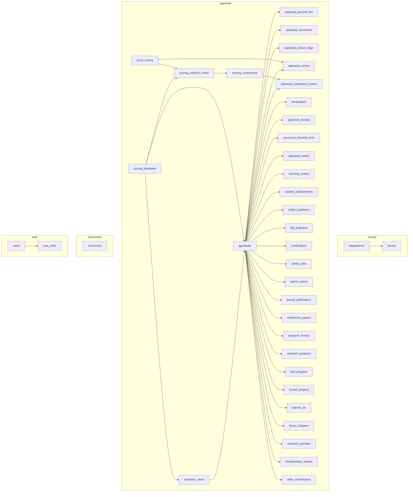

# Database Design (PostgreSQL)

> **PROPOSED.** PostgreSQL, **not** MySQL. Normalised relational tables for repeating appraisal data. **The appraisal is never stored as one giant JSON document.**

Related: [domain-model.md](domain-model.md) · [api-contract.md](api-contract.md) · [service-boundaries.md](service-boundaries.md)

**Verified:** every `sql` block in this document was executed, in order, on a real PostgreSQL engine (PGlite, a WebAssembly build of PostgreSQL): 4 schemas, 39 tables, no errors.

- **Confirmed template rules are enforced.** Every cadre totals 100 over 9 criteria; every set of components adds up to its criterion maximum (a set that does not add up is rejected at COMMIT, while a balanced edit inside one transaction is accepted); exactly the four criteria B6 to B9 have no components; no tenth criterion; no duplicate component number or template version; unknown cadre, indexing, document type and role are rejected; plus the appraisal-level rules (one appraisal per faculty and year, one current academic year, and so on).
- **Unconfirmed score relationships are NOT enforced.** Accepted by the database, on purpose: criterion self-score 24 with component self-scores adding up to 25; a total that is not the sum of the criteria; a self-score above its maximum; a criterion score with no component scores; component scores left empty; fractional marks. The only sign rule rejected is a negative mark (PROVISIONAL).
- **Scoring mechanics.** Template versioning (a v2 template alongside v1), an appraisal remembering its template, copying of criterion and component maxima onto the score rows (9 criteria, 21 components for an Assistant Professor, maximum 100, components covering B1 to B5 only = 82), the `version` bump, `updated_at` trigger and cascade delete through the score sheet.

## 1. Decisions

| Topic | Decision | Why |
|---|---|---|
| Engine | PostgreSQL 15+ | required; `gen_random_uuid()` in core, `timestamptz`, partial indexes, `CREATE DOMAIN` |
| Isolation | **One cluster, one schema per service** (`auth`, `faculty`, `appraisal`, `documents`), one DB role per schema | cheap to run now, splittable later |
| Cross-service links | **ids by value, no foreign keys across schemas** (`faculty_id`, `appraisal_id`) | each service can move to its own database |
| Keys | `uuid` primary keys. Repeating rows accept a **client-supplied** uuid (contract rule); the server rejects an id that already belongs to another appraisal | stable ids across autosaves |
| Appraisal identity | `appraisals` is unique on **(faculty_id, academic_year_id)** | requirement |
| Repeating sections | one child table per PDF table, `appraisal_id` FK `ON DELETE CASCADE`, `sort_order` for row order | normalised; queryable; per-column types and checks |
| Enumerations | `CREATE DOMAIN … AS text CHECK (VALUE IN (…))`, one per PDF-closed set | readable, shareable inside a schema, adding a value is a one-line migration, no `ALTER TYPE` limits |
| Status | `text` + `CHECK`; `NOT_STARTED` is **never stored** (no row = not started) | statuses after `SUBMITTED` are PROVISIONAL, so keep them easy to change |
| Numbers | `numeric` for percentages/hours/money, `integer` for counts, with range checks | exact decimals; sanity checks mirror the UI |
| Dates | `date` for dates; month-year stored as `date` = first day of month (API `YYYY-MM`) | native comparison/sorting |
| Concurrency | `appraisals.version`; write with `UPDATE … WHERE id = $1 AND version = $2` | `If-Match` / `412` |
| Scoring rules | **Versioned `scoring_templates`** → cadre → criterion → **component** → maximum marks; each academic year points at the template in force; each appraisal copies that template id and, when scored, copies the maxima onto its own score rows | rules can change by year or version without rewriting history. See §10 |
| Scoring formula | **none stored, none modelled.** Maximum marks (criterion and component) and three independent self-score values (total, criterion, component), each supplied by the backend | the source documents define no calculation and no relationship between the levels. REQUIRES COLLEGE CONFIRMATION |
| Score constraints | the database validates **template maximum marks** only; it enforces **no relationship between self-scores** and does not cap a self-score at its maximum | an unconfirmed rule must not be baked into the schema. See 4.6 |
| Nullability | content columns are **nullable**; only keys and bookkeeping are `NOT NULL` | "which fields are required" is a PROVISIONAL UI rule (api-contract §9 #1), so the database must not hard-code it |
| Lengths | contract maxima enforced in the API; add `CHECK (char_length(col) <= n)` once the college confirms limits | avoids freezing guesses |

### JSON policy
`jsonb` is **not used for appraisal content**. It is permitted only for `appraisal_events.metadata` (free-form audit detail), where a fixed schema adds no value.

Why not one document per appraisal: per-column validation and types would be lost; reporting and cross-year queries (e.g. all journal papers by indexing, totals per department) would need JSON path queries; partial updates would rewrite the whole document and widen lost-update windows; schema evolution would need document migration; the PDF is already a set of well-defined tables.

## 2. Entity map



## 3. DDL: `faculty` schema (Faculty Service)

```sql
CREATE SCHEMA faculty;

CREATE TABLE faculty.departments (
  code       text PRIMARY KEY,                 -- CE, ME, ECE_ECT, EEE, CSE_IT, AIML_CAI_DS, BSH, MBA (PDF Part A)
  label      text NOT NULL,                    -- PDF wording: 'ECE / ECT', 'CSE / IT', …
  full_name  text                              -- PROVISIONAL: not in the PDF
);

CREATE TABLE faculty.faculty (
  id                                 uuid PRIMARY KEY DEFAULT gen_random_uuid(),
  user_id                            uuid NOT NULL UNIQUE,      -- auth.users.id (by value)
  employee_id                        varchar(50) UNIQUE,
  name                               varchar(200) NOT NULL,
  email                              varchar(254),
  contact_no                         varchar(30),
  department_code                    text REFERENCES faculty.departments(code),
  cadre                              text CHECK (cadre IN ('LECTURER','ASSISTANT_PROFESSOR','SENIOR_ASSISTANT_PROFESSOR',
                                                           'ASSOCIATE_PROFESSOR','PROFESSOR')),
  highest_qualification              varchar(300),
  phd_status                         text CHECK (phd_status IN ('AWARDED','PURSUING','NOT_APPLICABLE')),
  date_of_joining_institution        date,
  date_of_joining_present_designation date,
  experience_teaching_years          numeric(4,1) CHECK (experience_teaching_years >= 0),
  experience_industry_years          numeric(4,1) CHECK (experience_industry_years >= 0),
  experience_research_years          numeric(4,1) CHECK (experience_research_years >= 0),
  researcher_ids                     varchar(500),
  avatar_url                         text,
  active                             boolean NOT NULL DEFAULT true,
  created_at                         timestamptz NOT NULL DEFAULT now(),
  updated_at                         timestamptz NOT NULL DEFAULT now()
);
CREATE INDEX ix_faculty_department ON faculty.faculty (department_code);
```

## 4. DDL: `appraisal` schema (Appraisal Service)

### 4.1 Domains and reference data

```sql
CREATE SCHEMA appraisal;

CREATE DOMAIN appraisal.cadre_code AS text CHECK (VALUE IN
  ('LECTURER','ASSISTANT_PROFESSOR','SENIOR_ASSISTANT_PROFESSOR','ASSOCIATE_PROFESSOR','PROFESSOR'));
CREATE DOMAIN appraisal.phd_status_code        AS text CHECK (VALUE IN ('AWARDED','PURSUING','NOT_APPLICABLE'));
CREATE DOMAIN appraisal.level_code             AS text CHECK (VALUE IN ('INST','STATE','NAT','INTL'));
CREATE DOMAIN appraisal.conference_level_code  AS text CHECK (VALUE IN ('NAT','INTL'));
CREATE DOMAIN appraisal.project_level_code     AS text CHECK (VALUE IN ('DIPLOMA','UG','PG'));
CREATE DOMAIN appraisal.project_outcome_code   AS text CHECK (VALUE IN ('PAPER','PATENT','PROTOTYPE','COMPETITION'));
CREATE DOMAIN appraisal.program_mode_code      AS text CHECK (VALUE IN ('OFFLINE','ONLINE','BLENDED'));
CREATE DOMAIN appraisal.cert_platform_code     AS text CHECK (VALUE IN ('NPTEL','SWAYAM','COURSERA','OTHER'));
CREATE DOMAIN appraisal.journal_indexing_code  AS text CHECK (VALUE IN ('SCI','SCOPUS','UGC_CARE','ABDC','OTHERS'));
CREATE DOMAIN appraisal.research_platform_code AS text CHECK (VALUE IN ('GOOGLE_SCHOLAR','SCOPUS','WEB_OF_SCIENCE'));
CREATE DOMAIN appraisal.guidance_degree_code   AS text CHECK (VALUE IN ('PHD','MTECH','MBA'));
CREATE DOMAIN appraisal.guidance_status_code   AS text CHECK (VALUE IN ('REGISTERED','SUBMITTED','AWARDED'));
CREATE DOMAIN appraisal.phd_stage_code         AS text CHECK (VALUE IN
  ('COURSE_WORK','COMPREHENSIVE_PROPOSAL','SYNOPSIS_PRE_PHD','THESIS_SUBMITTED','VIVA_VOCE_COMPLETED'));
CREATE DOMAIN appraisal.funded_type_code       AS text CHECK (VALUE IN ('RESEARCH','CONSULTANCY'));
CREATE DOMAIN appraisal.funded_status_code     AS text CHECK (VALUE IN ('SANCTIONED','APPLIED'));
CREATE DOMAIN appraisal.ipr_type_code          AS text CHECK (VALUE IN ('DESIGN','UTILITY','COPYRIGHT'));
CREATE DOMAIN appraisal.ipr_status_code        AS text CHECK (VALUE IN ('FILED','PUBLISHED','GRANTED'));
CREATE DOMAIN appraisal.book_type_code         AS text CHECK (VALUE IN ('BOOK','CHAPTER'));
CREATE DOMAIN appraisal.criterion_code         AS text CHECK (VALUE IN
  ('TEACHING_LEARNING','STUDENT_MENTORING','FDP_CERTIFICATIONS','ADMINISTRATIVE','RESEARCH_PUBLICATIONS',
   'FUNDED_PROJECTS','PATENTS_BOOKS_IPR','OUTREACH','MEMBERSHIPS_AWARDS'));
CREATE DOMAIN appraisal.doc_type_code          AS text CHECK (VALUE IN
  ('COURSE_FILES_RESULT_ANALYSIS','STUDENT_FEEDBACK_REPORTS','MENTORING_RECORDS','PUBLICATION_PROOFS',
   'PROJECT_SANCTION_LETTERS','PATENT_BOOK_PROOFS','FDP_COURSE_CERTIFICATES','ROLE_APPOINTMENT_ORDERS',
   'EVENT_REPORTS','AWARDS_MEMBERSHIP_PROOFS','OTHERS'));
CREATE DOMAIN appraisal.percent_value  AS numeric(5,2) CHECK (VALUE BETWEEN 0 AND 100);   -- UI sanity rule
CREATE DOMAIN appraisal.count_value    AS integer      CHECK (VALUE >= 0);

-- Scoring rules are VERSIONED so they can change by academic year without rewriting history.
-- Conceptual chain: ScoringTemplate -> Cadre -> Criterion -> ScoringComponent -> MaximumMarks.
CREATE TABLE appraisal.scoring_templates (
  id               uuid PRIMARY KEY DEFAULT gen_random_uuid(),
  code             text NOT NULL,
  version          integer NOT NULL CHECK (version >= 1),
  name             text NOT NULL,
  source_document  text,                                   -- which college document defined it
  status           text NOT NULL DEFAULT 'DRAFT' CHECK (status IN ('DRAFT','ACTIVE','RETIRED')),
  created_at       timestamptz NOT NULL DEFAULT now(),
  UNIQUE (code, version)
);   -- ACTIVE and RETIRED templates are immutable; a rule change is a NEW version (service rule, PROPOSED)

CREATE TABLE appraisal.score_criteria (                    -- the nine criteria of the score sheet; no tenth
  code    appraisal.criterion_code PRIMARY KEY,
  number  smallint NOT NULL UNIQUE CHECK (number BETWEEN 1 AND 9),
  title   text NOT NULL
);

-- Criterion maximum marks by cadre (Annexure A)
CREATE TABLE appraisal.scoring_criterion_marks (
  template_id  uuid NOT NULL REFERENCES appraisal.scoring_templates(id),
  cadre        appraisal.cadre_code     NOT NULL,
  criterion    appraisal.criterion_code NOT NULL REFERENCES appraisal.score_criteria(code),
  max_marks    smallint NOT NULL CHECK (max_marks >= 0),
  PRIMARY KEY (template_id, cadre, criterion)
);

-- Component maximum marks (scoring annexure, B1 to B5 only). No row exists for B6 to B9.
-- `component_no` is the position in the annexure listing for that cadre and criterion. Wording and number of
-- components differ between cadres, so a component is NOT comparable across cadres by number.
CREATE TABLE appraisal.scoring_components (
  id            uuid PRIMARY KEY DEFAULT gen_random_uuid(),
  template_id   uuid NOT NULL,
  cadre         appraisal.cadre_code     NOT NULL,
  criterion     appraisal.criterion_code NOT NULL,
  component_no  smallint NOT NULL CHECK (component_no >= 1),
  label         text NOT NULL,                              -- verbatim from the annexure
  max_marks     smallint NOT NULL CHECK (max_marks >= 0),
  UNIQUE (template_id, cadre, criterion, component_no),
  FOREIGN KEY (template_id, cadre, criterion)
    REFERENCES appraisal.scoring_criterion_marks (template_id, cadre, criterion)
);

-- Where components exist they must add up to the criterion maximum. Checked at COMMIT so a template
-- can be loaded or edited in one transaction. (Criteria without components, B6 to B9, are not checked.)
CREATE FUNCTION appraisal.check_component_sums() RETURNS trigger LANGUAGE plpgsql AS
$$
DECLARE r record;
BEGIN
  FOR r IN
    SELECT m.cadre, m.criterion, m.max_marks, SUM(c.max_marks) AS comp_sum
    FROM appraisal.scoring_criterion_marks m
    JOIN appraisal.scoring_components c USING (template_id, cadre, criterion)
    WHERE m.template_id = COALESCE(NEW.template_id, OLD.template_id)
    GROUP BY m.cadre, m.criterion, m.max_marks
    HAVING SUM(c.max_marks) <> m.max_marks
  LOOP
    RAISE EXCEPTION 'components of % / % add up to % but the criterion maximum is %', r.cadre, r.criterion, r.comp_sum, r.max_marks;
  END LOOP;
  RETURN NULL;
END
$$;
CREATE CONSTRAINT TRIGGER trg_components_sum AFTER INSERT OR UPDATE OR DELETE ON appraisal.scoring_components
  DEFERRABLE INITIALLY DEFERRED FOR EACH ROW EXECUTE FUNCTION appraisal.check_component_sums();
CREATE CONSTRAINT TRIGGER trg_criterion_marks_sum AFTER UPDATE OR DELETE ON appraisal.scoring_criterion_marks
  DEFERRABLE INITIALLY DEFERRED FOR EACH ROW EXECUTE FUNCTION appraisal.check_component_sums();

CREATE TABLE appraisal.academic_years (
  id                   uuid PRIMARY KEY DEFAULT gen_random_uuid(),
  label                text NOT NULL UNIQUE CHECK (label ~ '^\d{4}-\d{2}$'),    -- '2025-26'
  is_current           boolean NOT NULL DEFAULT false,                         -- PROVISIONAL
  scoring_template_id  uuid REFERENCES appraisal.scoring_templates(id)         -- the rule set in force for this year (PROVISIONAL assignment)
);
CREATE UNIQUE INDEX uq_one_current_year ON appraisal.academic_years (is_current) WHERE is_current;
```

### 4.2 Seed data: criteria, scoring template, Annexure A and the B1 to B5 components

Generated from `frontend/src/data/scoring.ts`, which was checked against the source documents (45 criterion maxima, 102 components).

```sql
INSERT INTO appraisal.score_criteria (code, number, title) VALUES
 ('TEACHING_LEARNING', 1, 'Teaching & Learning'),
 ('STUDENT_MENTORING', 2, 'Student Mentoring, Guidance & Achievements'),
 ('FDP_CERTIFICATIONS', 3, 'FDPs / Certifications'),
 ('ADMINISTRATIVE', 4, 'Administrative, Curriculum & Quality Contributions'),
 ('RESEARCH_PUBLICATIONS', 5, 'Research & Publications'),
 ('FUNDED_PROJECTS', 6, 'Funded Projects / Consultancy'),
 ('PATENTS_BOOKS_IPR', 7, 'Patents, Books & IPR'),
 ('OUTREACH', 8, 'Outreach'),
 ('MEMBERSHIPS_AWARDS', 9, 'Professional Memberships, Awards & Recognitions');

-- One versioned template. Source: Annexure A (criterion maxima) + "Scoring criteria B1 to B5 (Annexure A & B)" (components).
INSERT INTO appraisal.scoring_templates (code, version, name, source_document, status) VALUES
 ('SVEC-SCORING', 1, 'Sri Vasavi faculty self-appraisal scoring, v1',
  'Faculty Self-Appraisal & Assessment Report (Annexure A); Scoring criteria B1 to B5 (Annexure A & B)', 'ACTIVE');

-- Criterion maximum marks by cadre (Annexure A): 5 cadres x 9 criteria = 45 rows
INSERT INTO appraisal.scoring_criterion_marks (template_id, cadre, criterion, max_marks)
SELECT t.id, v.cadre, v.criterion, v.max_marks
FROM appraisal.scoring_templates t,
 (VALUES
 ('LECTURER','TEACHING_LEARNING',40),('LECTURER','STUDENT_MENTORING',15),('LECTURER','FDP_CERTIFICATIONS',15),('LECTURER','ADMINISTRATIVE',15),('LECTURER','RESEARCH_PUBLICATIONS',5),('LECTURER','FUNDED_PROJECTS',0),('LECTURER','PATENTS_BOOKS_IPR',0),('LECTURER','OUTREACH',5),('LECTURER','MEMBERSHIPS_AWARDS',5),
 ('ASSISTANT_PROFESSOR','TEACHING_LEARNING',30),('ASSISTANT_PROFESSOR','STUDENT_MENTORING',12),('ASSISTANT_PROFESSOR','FDP_CERTIFICATIONS',10),('ASSISTANT_PROFESSOR','ADMINISTRATIVE',15),('ASSISTANT_PROFESSOR','RESEARCH_PUBLICATIONS',15),('ASSISTANT_PROFESSOR','FUNDED_PROJECTS',5),('ASSISTANT_PROFESSOR','PATENTS_BOOKS_IPR',3),('ASSISTANT_PROFESSOR','OUTREACH',5),('ASSISTANT_PROFESSOR','MEMBERSHIPS_AWARDS',5),
 ('SENIOR_ASSISTANT_PROFESSOR','TEACHING_LEARNING',25),('SENIOR_ASSISTANT_PROFESSOR','STUDENT_MENTORING',10),('SENIOR_ASSISTANT_PROFESSOR','FDP_CERTIFICATIONS',8),('SENIOR_ASSISTANT_PROFESSOR','ADMINISTRATIVE',15),('SENIOR_ASSISTANT_PROFESSOR','RESEARCH_PUBLICATIONS',20),('SENIOR_ASSISTANT_PROFESSOR','FUNDED_PROJECTS',7),('SENIOR_ASSISTANT_PROFESSOR','PATENTS_BOOKS_IPR',5),('SENIOR_ASSISTANT_PROFESSOR','OUTREACH',5),('SENIOR_ASSISTANT_PROFESSOR','MEMBERSHIPS_AWARDS',5),
 ('ASSOCIATE_PROFESSOR','TEACHING_LEARNING',20),('ASSOCIATE_PROFESSOR','STUDENT_MENTORING',8),('ASSOCIATE_PROFESSOR','FDP_CERTIFICATIONS',5),('ASSOCIATE_PROFESSOR','ADMINISTRATIVE',15),('ASSOCIATE_PROFESSOR','RESEARCH_PUBLICATIONS',25),('ASSOCIATE_PROFESSOR','FUNDED_PROJECTS',10),('ASSOCIATE_PROFESSOR','PATENTS_BOOKS_IPR',7),('ASSOCIATE_PROFESSOR','OUTREACH',5),('ASSOCIATE_PROFESSOR','MEMBERSHIPS_AWARDS',5),
 ('PROFESSOR','TEACHING_LEARNING',15),('PROFESSOR','STUDENT_MENTORING',5),('PROFESSOR','FDP_CERTIFICATIONS',5),('PROFESSOR','ADMINISTRATIVE',20),('PROFESSOR','RESEARCH_PUBLICATIONS',25),('PROFESSOR','FUNDED_PROJECTS',12),('PROFESSOR','PATENTS_BOOKS_IPR',8),('PROFESSOR','OUTREACH',5),('PROFESSOR','MEMBERSHIPS_AWARDS',5)
 ) AS v(cadre, criterion, max_marks)
WHERE t.code = 'SVEC-SCORING' AND t.version = 1;

-- Component maximum marks, B1 to B5 only (scoring annexure): 102 rows. Labels verbatim.
-- B6 to B9 have NO component rows: no breakdown is defined for them.
INSERT INTO appraisal.scoring_components (template_id, cadre, criterion, component_no, label, max_marks)
SELECT t.id, v.cadre, v.criterion, v.component_no, v.label, v.max_marks
FROM appraisal.scoring_templates t,
 (VALUES
 ('LECTURER','TEACHING_LEARNING',1,'Workload & course delivery',10),
 ('LECTURER','TEACHING_LEARNING',2,'Pass/result performance',10),
 ('LECTURER','TEACHING_LEARNING',3,'Student feedback',8),
 ('LECTURER','TEACHING_LEARNING',4,'Course-file/assessment quality',6),
 ('LECTURER','TEACHING_LEARNING',5,'Innovative/remedial/advanced-learning practices',6),
 ('LECTURER','STUDENT_MENTORING',1,'Mentoring records & attendance/academic follow-up',5),
 ('LECTURER','STUDENT_MENTORING',2,'Project/lab guidance',4),
 ('LECTURER','STUDENT_MENTORING',3,'Student achievement support',4),
 ('LECTURER','STUDENT_MENTORING',4,'Parent/student support evidence',2),
 ('LECTURER','FDP_CERTIFICATIONS',1,'FDP/workshops/training',10),
 ('LECTURER','FDP_CERTIFICATIONS',2,'Relevant certification',5),
 ('LECTURER','ADMINISTRATIVE',1,'Department responsibilities',5),
 ('LECTURER','ADMINISTRATIVE',2,'Institute committees/events',3),
 ('LECTURER','ADMINISTRATIVE',3,'Curriculum/BoS/academic support',3),
 ('LECTURER','ADMINISTRATIVE',4,'Quality/accreditation contributions',2),
 ('LECTURER','ADMINISTRATIVE',5,'Measurable institutional/student-service contribution',2),
 ('LECTURER','RESEARCH_PUBLICATIONS',1,'Quality publications',3),
 ('LECTURER','RESEARCH_PUBLICATIONS',2,'Citations/research profile',1),
 ('LECTURER','RESEARCH_PUBLICATIONS',3,'Research activity/collaboration',1),

 ('ASSISTANT_PROFESSOR','TEACHING_LEARNING',1,'Workload & course delivery',8),
 ('ASSISTANT_PROFESSOR','TEACHING_LEARNING',2,'Pass/result performance',8),
 ('ASSISTANT_PROFESSOR','TEACHING_LEARNING',3,'Feedback',6),
 ('ASSISTANT_PROFESSOR','TEACHING_LEARNING',4,'Course-file/assessment quality',4),
 ('ASSISTANT_PROFESSOR','TEACHING_LEARNING',5,'Innovation/remedial/advanced learning',4),
 ('ASSISTANT_PROFESSOR','STUDENT_MENTORING',1,'Mentoring',4),
 ('ASSISTANT_PROFESSOR','STUDENT_MENTORING',2,'Project guidance',3),
 ('ASSISTANT_PROFESSOR','STUDENT_MENTORING',3,'Student achievements',3),
 ('ASSISTANT_PROFESSOR','STUDENT_MENTORING',4,'Academic/placement/competitive-exam support',2),
 ('ASSISTANT_PROFESSOR','FDP_CERTIFICATIONS',1,'FDP/workshops/training',6),
 ('ASSISTANT_PROFESSOR','FDP_CERTIFICATIONS',2,'Relevant certification',4),
 ('ASSISTANT_PROFESSOR','ADMINISTRATIVE',1,'Department responsibilities',4),
 ('ASSISTANT_PROFESSOR','ADMINISTRATIVE',2,'Institute roles',3),
 ('ASSISTANT_PROFESSOR','ADMINISTRATIVE',3,'Curriculum/BoS',3),
 ('ASSISTANT_PROFESSOR','ADMINISTRATIVE',4,'Quality/accreditation',3),
 ('ASSISTANT_PROFESSOR','ADMINISTRATIVE',5,'Measurable institutional contribution',2),
 ('ASSISTANT_PROFESSOR','RESEARCH_PUBLICATIONS',1,'SCI/SCIE/quality Scopus publications',8),
 ('ASSISTANT_PROFESSOR','RESEARCH_PUBLICATIONS',2,'Other eligible publications',2),
 ('ASSISTANT_PROFESSOR','RESEARCH_PUBLICATIONS',3,'Citations/profile',2),
 ('ASSISTANT_PROFESSOR','RESEARCH_PUBLICATIONS',4,'Conference/research dissemination',1),
 ('ASSISTANT_PROFESSOR','RESEARCH_PUBLICATIONS',5,'Research collaboration/academic output',2),

 ('SENIOR_ASSISTANT_PROFESSOR','TEACHING_LEARNING',1,'Workload & course delivery',6),
 ('SENIOR_ASSISTANT_PROFESSOR','TEACHING_LEARNING',2,'Result performance',6),
 ('SENIOR_ASSISTANT_PROFESSOR','TEACHING_LEARNING',3,'Feedback',5),
 ('SENIOR_ASSISTANT_PROFESSOR','TEACHING_LEARNING',4,'Course/assessment quality',4),
 ('SENIOR_ASSISTANT_PROFESSOR','TEACHING_LEARNING',5,'Innovation/academic contribution',4),
 ('SENIOR_ASSISTANT_PROFESSOR','STUDENT_MENTORING',1,'Mentoring quality',3),
 ('SENIOR_ASSISTANT_PROFESSOR','STUDENT_MENTORING',2,'Project guidance',3),
 ('SENIOR_ASSISTANT_PROFESSOR','STUDENT_MENTORING',3,'Student achievements',2),
 ('SENIOR_ASSISTANT_PROFESSOR','STUDENT_MENTORING',4,'Academic/placement support',2),
 ('SENIOR_ASSISTANT_PROFESSOR','FDP_CERTIFICATIONS',1,'FDP/workshops/training',5),
 ('SENIOR_ASSISTANT_PROFESSOR','FDP_CERTIFICATIONS',2,'Certification',3),
 ('SENIOR_ASSISTANT_PROFESSOR','ADMINISTRATIVE',1,'Department/institute responsibility',4),
 ('SENIOR_ASSISTANT_PROFESSOR','ADMINISTRATIVE',2,'Curriculum/BoS',3),
 ('SENIOR_ASSISTANT_PROFESSOR','ADMINISTRATIVE',3,'Quality/accreditation',4),
 ('SENIOR_ASSISTANT_PROFESSOR','ADMINISTRATIVE',4,'Committee/event leadership',2),
 ('SENIOR_ASSISTANT_PROFESSOR','ADMINISTRATIVE',5,'Institutional improvement',2),
 ('SENIOR_ASSISTANT_PROFESSOR','RESEARCH_PUBLICATIONS',1,'SCI/SCIE/quality Scopus publications',10),
 ('SENIOR_ASSISTANT_PROFESSOR','RESEARCH_PUBLICATIONS',2,'Citations/profile',3),
 ('SENIOR_ASSISTANT_PROFESSOR','RESEARCH_PUBLICATIONS',3,'Conference/research dissemination',2),
 ('SENIOR_ASSISTANT_PROFESSOR','RESEARCH_PUBLICATIONS',4,'Research collaboration',2),
 ('SENIOR_ASSISTANT_PROFESSOR','RESEARCH_PUBLICATIONS',5,'Ph.D./PG research guidance',3),

 ('ASSOCIATE_PROFESSOR','TEACHING_LEARNING',1,'Course delivery/workload',5),
 ('ASSOCIATE_PROFESSOR','TEACHING_LEARNING',2,'Result/academic quality',5),
 ('ASSOCIATE_PROFESSOR','TEACHING_LEARNING',3,'Feedback',4),
 ('ASSOCIATE_PROFESSOR','TEACHING_LEARNING',4,'Course/assessment development',3),
 ('ASSOCIATE_PROFESSOR','TEACHING_LEARNING',5,'Innovative teaching/academic leadership',3),
 ('ASSOCIATE_PROFESSOR','STUDENT_MENTORING',1,'Mentoring',2),
 ('ASSOCIATE_PROFESSOR','STUDENT_MENTORING',2,'Project/PG guidance',2),
 ('ASSOCIATE_PROFESSOR','STUDENT_MENTORING',3,'Student achievements',2),
 ('ASSOCIATE_PROFESSOR','STUDENT_MENTORING',4,'Advanced learner/placement/research support',2),
 ('ASSOCIATE_PROFESSOR','FDP_CERTIFICATIONS',1,'FDP/workshops/training',3),
 ('ASSOCIATE_PROFESSOR','FDP_CERTIFICATIONS',2,'Certification',2),
 ('ASSOCIATE_PROFESSOR','ADMINISTRATIVE',1,'Academic/administrative leadership',4),
 ('ASSOCIATE_PROFESSOR','ADMINISTRATIVE',2,'Curriculum/BoS',3),
 ('ASSOCIATE_PROFESSOR','ADMINISTRATIVE',3,'Quality/accreditation',4),
 ('ASSOCIATE_PROFESSOR','ADMINISTRATIVE',4,'Committee/institutional leadership',2),
 ('ASSOCIATE_PROFESSOR','ADMINISTRATIVE',5,'Measurable improvement',2),
 ('ASSOCIATE_PROFESSOR','RESEARCH_PUBLICATIONS',1,'Quality journal publications',12),
 ('ASSOCIATE_PROFESSOR','RESEARCH_PUBLICATIONS',2,'Citations/research impact',4),
 ('ASSOCIATE_PROFESSOR','RESEARCH_PUBLICATIONS',3,'Research guidance',4),
 ('ASSOCIATE_PROFESSOR','RESEARCH_PUBLICATIONS',4,'Conference/research dissemination',2),
 ('ASSOCIATE_PROFESSOR','RESEARCH_PUBLICATIONS',5,'Collaboration/research leadership',3),

 ('PROFESSOR','TEACHING_LEARNING',1,'Teaching quality/workload',4),
 ('PROFESSOR','TEACHING_LEARNING',2,'Result/academic quality',4),
 ('PROFESSOR','TEACHING_LEARNING',3,'Feedback',3),
 ('PROFESSOR','TEACHING_LEARNING',4,'Curriculum/assessment contribution',2),
 ('PROFESSOR','TEACHING_LEARNING',5,'Innovative teaching/academic leadership',2),
 ('PROFESSOR','STUDENT_MENTORING',1,'Academic/research mentoring',2),
 ('PROFESSOR','STUDENT_MENTORING',2,'Student/project/PG guidance',1),
 ('PROFESSOR','STUDENT_MENTORING',3,'Significant student achievements',2),
 ('PROFESSOR','FDP_CERTIFICATIONS',1,'Relevant advanced FDP/training',3),
 ('PROFESSOR','FDP_CERTIFICATIONS',2,'Certification/academic updating',2),
 ('PROFESSOR','ADMINISTRATIVE',1,'Academic/institutional leadership',5),
 ('PROFESSOR','ADMINISTRATIVE',2,'Curriculum/BoS',4),
 ('PROFESSOR','ADMINISTRATIVE',3,'Quality/accreditation',5),
 ('PROFESSOR','ADMINISTRATIVE',4,'Major institutional responsibility',3),
 ('PROFESSOR','ADMINISTRATIVE',5,'Measurable institutional development',3),
 ('PROFESSOR','RESEARCH_PUBLICATIONS',1,'Quality journal publications',10),
 ('PROFESSOR','RESEARCH_PUBLICATIONS',2,'Citations/research impact',5),
 ('PROFESSOR','RESEARCH_PUBLICATIONS',3,'Ph.D./PG guidance',5),
 ('PROFESSOR','RESEARCH_PUBLICATIONS',4,'Research leadership/collaboration',3),
 ('PROFESSOR','RESEARCH_PUBLICATIONS',5,'Conference/editorial/reviewer contributions',2)
 ) AS v(cadre, criterion, component_no, label, max_marks)
WHERE t.code = 'SVEC-SCORING' AND t.version = 1;

-- PROVISIONAL: which academic years use which template is a college decision.
-- Placeholder: assign template v1 to every year that exists when the migration runs.
UPDATE appraisal.academic_years
SET scoring_template_id = (SELECT id FROM appraisal.scoring_templates WHERE code = 'SVEC-SCORING' AND version = 1);
```

Migration tests (run in CI; the first two must return **zero rows**; the third is informational):

```sql
-- 1. every cadre has exactly 9 criteria totalling 100
SELECT template_id, cadre FROM appraisal.scoring_criterion_marks
GROUP BY template_id, cadre HAVING SUM(max_marks) <> 100 OR COUNT(*) <> 9;

-- 2. wherever components exist, they add up to the criterion maximum (also enforced by trg_components_sum)
SELECT m.template_id, m.cadre, m.criterion
FROM appraisal.scoring_criterion_marks m
JOIN appraisal.scoring_components c USING (template_id, cadre, criterion)
GROUP BY m.template_id, m.cadre, m.criterion, m.max_marks
HAVING SUM(c.max_marks) <> m.max_marks;

-- 3. INFORMATIONAL: criteria that have NO components. Expected for every cadre: the four B6 to B9 criteria
SELECT DISTINCT m.criterion
FROM appraisal.scoring_criterion_marks m
LEFT JOIN appraisal.scoring_components c USING (template_id, cadre, criterion)
WHERE c.id IS NULL ORDER BY 1;
```

### 4.3 The appraisal and its 1:1 parts

```sql
CREATE TABLE appraisal.appraisals (
  id                uuid PRIMARY KEY DEFAULT gen_random_uuid(),
  faculty_id        uuid NOT NULL,                                   -- faculty.faculty.id (by value)
  academic_year_id  uuid NOT NULL REFERENCES appraisal.academic_years(id),
  scoring_template_id uuid REFERENCES appraisal.scoring_templates(id),   -- copied from the year at creation: later rule changes never touch this appraisal
  status            text NOT NULL DEFAULT 'DRAFT'
                    CHECK (status IN ('DRAFT','SUBMITTED','UNDER_REVIEW','APPROVED','RETURNED','REJECTED')),
                    -- 'NOT_STARTED' is never stored. Only DRAFT and SUBMITTED are certain; the rest PROVISIONAL.
  version           integer NOT NULL DEFAULT 1 CHECK (version >= 1),
  submitted_at      timestamptz,
  created_at        timestamptz NOT NULL DEFAULT now(),
  updated_at        timestamptz NOT NULL DEFAULT now(),
  CONSTRAINT uq_appraisal_faculty_year UNIQUE (faculty_id, academic_year_id)
);

-- Part A: snapshot of the faculty profile, owned by the appraisal.
CREATE TABLE appraisal.appraisal_general_info (
  appraisal_id                        uuid PRIMARY KEY REFERENCES appraisal.appraisals(id) ON DELETE CASCADE,
  faculty_name                        varchar(200),
  employee_id                         varchar(50),
  contact_no                          varchar(30),
  department_code                     text,                           -- by value (Faculty Service reference)
  cadre                               appraisal.cadre_code,           -- drives the maximum marks
  highest_qualification               varchar(300),
  phd_status                          appraisal.phd_status_code,
  date_of_joining_institution         date,
  date_of_joining_present_designation date,
  experience_teaching_years           numeric(4,1) CHECK (experience_teaching_years >= 0),
  experience_industry_years           numeric(4,1) CHECK (experience_industry_years >= 0),
  experience_research_years           numeric(4,1) CHECK (experience_research_years >= 0),
  email                               varchar(254),
  researcher_ids                      varchar(500)
  -- academic year is NOT repeated here: it is the appraisal's academic_year_id
);

-- The PDF's typed totals/counts. PROVISIONAL: typed by faculty, not derived from the rows.
CREATE TABLE appraisal.appraisal_summaries (
  appraisal_id                          uuid PRIMARY KEY REFERENCES appraisal.appraisals(id) ON DELETE CASCADE,
  teaching_total_load_hrs_per_week      numeric(5,2) CHECK (teaching_total_load_hrs_per_week >= 0),
  teaching_average_pass_percent         appraisal.percent_value,
  teaching_average_feedback_percent     appraisal.percent_value,
  mentoring_total_students_mentored     appraisal.count_value,
  journal_count_sci_scie                appraisal.count_value,
  journal_count_scopus                  appraisal.count_value,
  journal_count_ugc_care_abdc           appraisal.count_value,
  journal_count_others                  appraisal.count_value,
  projects_sanctioned_count             appraisal.count_value,
  projects_applied_count                appraisal.count_value,
  projects_total_amount_sanctioned_rs   numeric(14,2) CHECK (projects_total_amount_sanctioned_rs >= 0),
  projects_consultancy_revenue_rs       numeric(14,2) CHECK (projects_consultancy_revenue_rs >= 0),
  patents_filed                         appraisal.count_value,
  patents_published                     appraisal.count_value,
  patents_granted                       appraisal.count_value,
  books_published                       appraisal.count_value,
  book_chapters_published               appraisal.count_value,
  documents_others_specify              text                            -- "Others: ______" of the checklist
);

-- PROVISIONAL UI feature: "nothing to report here". Not in the PDF.
CREATE TABLE appraisal.appraisal_section_flags (
  appraisal_id  uuid NOT NULL REFERENCES appraisal.appraisals(id) ON DELETE CASCADE,
  block_path    text NOT NULL,                                          -- e.g. 'teaching.entries'
  PRIMARY KEY (appraisal_id, block_path)
);

CREATE TABLE appraisal.other_contributions (          -- B10: two free-text areas, not a table, not scored
  appraisal_id      uuid PRIMARY KEY REFERENCES appraisal.appraisals(id) ON DELETE CASCADE,
  department_level  text,
  institute_level   text
);

CREATE TABLE appraisal.declarations (                 -- mechanism PROVISIONAL (PDF: Date, Place, Signature of Faculty)
  appraisal_id  uuid PRIMARY KEY REFERENCES appraisal.appraisals(id) ON DELETE CASCADE,
  declared_on   date,
  place         varchar(200),
  signature     varchar(200),                           -- typed name as digital stand-in
  recorded_at   timestamptz NOT NULL DEFAULT now()
);
```

### 4.4 Repeating sections (one table per PDF table)

Every table has `id uuid PRIMARY KEY` (client-supplied), `appraisal_id … ON DELETE CASCADE`, `sort_order`, and an index on `(appraisal_id, sort_order)`. Content columns are nullable (see §1, Nullability).

```sql
-- B1 Teaching
CREATE TABLE appraisal.teaching_entries (
  id uuid PRIMARY KEY,
  appraisal_id uuid NOT NULL REFERENCES appraisal.appraisals(id) ON DELETE CASCADE,
  sort_order integer NOT NULL,
  course_code_name text, program_branch text, semester text,
  num_sections appraisal.count_value,
  hours_per_week numeric(5,2) CHECK (hours_per_week >= 0),
  pass_percent appraisal.percent_value,
  phase1_feedback_percent appraisal.percent_value,
  phase2_feedback_percent appraisal.percent_value
);

-- B2 Mentoring
CREATE TABLE appraisal.student_achievements (
  id uuid PRIMARY KEY,
  appraisal_id uuid NOT NULL REFERENCES appraisal.appraisals(id) ON DELETE CASCADE,
  sort_order integer NOT NULL,
  student_name_roll_no text, achievement text,
  level appraisal.level_code,
  month_year date                                    -- first day of the month
);
CREATE TABLE appraisal.project_guidance (
  id uuid PRIMARY KEY,
  appraisal_id uuid NOT NULL REFERENCES appraisal.appraisals(id) ON DELETE CASCADE,
  sort_order integer NOT NULL,
  level appraisal.project_level_code, project_title text,
  num_students appraisal.count_value, outcome appraisal.project_outcome_code
);

-- B3 FDPs / Certifications
CREATE TABLE appraisal.fdp_programs (
  id uuid PRIMARY KEY,
  appraisal_id uuid NOT NULL REFERENCES appraisal.appraisals(id) ON DELETE CASCADE,
  sort_order integer NOT NULL,
  title text, mode appraisal.program_mode_code, organizer_venue text,
  duration_from date, duration_to date, num_days appraisal.count_value,
  CHECK (duration_to IS NULL OR duration_from IS NULL OR duration_to >= duration_from)
);
CREATE TABLE appraisal.certifications (
  id uuid PRIMARY KEY,
  appraisal_id uuid NOT NULL REFERENCES appraisal.appraisals(id) ON DELETE CASCADE,
  sort_order integer NOT NULL,
  platform appraisal.cert_platform_code, course_title text,
  duration_from date, duration_to date, duration_weeks_hours text, grade_score text,
  CHECK (duration_to IS NULL OR duration_from IS NULL OR duration_to >= duration_from)
);

-- B4 Administrative (two scopes share one table; the API exposes two lists)
CREATE TABLE appraisal.admin_roles (
  id uuid PRIMARY KEY,
  appraisal_id uuid NOT NULL REFERENCES appraisal.appraisals(id) ON DELETE CASCADE,
  scope text NOT NULL CHECK (scope IN ('INSTITUTE','DEPARTMENT')),
  sort_order integer NOT NULL,
  role text, responsibility text, period text         -- period format PROVISIONAL
);
CREATE TABLE appraisal.admin_events (
  id uuid PRIMARY KEY,
  appraisal_id uuid NOT NULL REFERENCES appraisal.appraisals(id) ON DELETE CASCADE,
  sort_order integer NOT NULL,
  activity_type text, role text, title_details text,
  duration_from date, duration_to date, num_beneficiaries appraisal.count_value,
  CHECK (duration_to IS NULL OR duration_from IS NULL OR duration_to >= duration_from)
);

-- B5 Research & Publications
CREATE TABLE appraisal.journal_publications (
  id uuid PRIMARY KEY,
  appraisal_id uuid NOT NULL REFERENCES appraisal.appraisals(id) ON DELETE CASCADE,
  sort_order integer NOT NULL,
  title text,                                         -- includes the author-position mark (PDF)
  journal_name text, vol_issue_page text, month_year date,
  indexing appraisal.journal_indexing_code, doi_issn text
);
CREATE TABLE appraisal.conference_papers (
  id uuid PRIMARY KEY,
  appraisal_id uuid NOT NULL REFERENCES appraisal.appraisals(id) ON DELETE CASCADE,
  sort_order integer NOT NULL,
  title text, conference_name text, level appraisal.conference_level_code, month_year date,
  venue text, doi_indexed_in text, num_citations appraisal.count_value
);
CREATE TABLE appraisal.research_metrics (              -- B5(c): one row per platform, max 3
  appraisal_id uuid NOT NULL REFERENCES appraisal.appraisals(id) ON DELETE CASCADE,
  platform appraisal.research_platform_code NOT NULL,
  total_publications appraisal.count_value, total_citations appraisal.count_value,
  h_index appraisal.count_value, i10_index appraisal.count_value,
  PRIMARY KEY (appraisal_id, platform)
);
CREATE TABLE appraisal.research_guidance (             -- B5(d)(i)
  id uuid PRIMARY KEY,
  appraisal_id uuid NOT NULL REFERENCES appraisal.appraisals(id) ON DELETE CASCADE,
  sort_order integer NOT NULL,
  scholar_name text, degree appraisal.guidance_degree_code, university_reg_no text,
  status appraisal.guidance_status_code, year text
);
CREATE TABLE appraisal.phd_progress (                  -- B5(d)(ii): own Ph.D. progress (if pursuing)
  appraisal_id uuid PRIMARY KEY REFERENCES appraisal.appraisals(id) ON DELETE CASCADE,
  university_center text, year_of_registration text,
  current_stage appraisal.phd_stage_code, progress_during_year text
);

-- B6 Funded projects / consultancy
CREATE TABLE appraisal.funded_projects (
  id uuid PRIMARY KEY,
  appraisal_id uuid NOT NULL REFERENCES appraisal.appraisals(id) ON DELETE CASCADE,
  sort_order integer NOT NULL,
  title text, role_team text, type appraisal.funded_type_code, funding_agency_client text,
  amount_rs numeric(14,2) CHECK (amount_rs >= 0),
  duration_from date, duration_to date, status appraisal.funded_status_code, year text,
  CHECK (duration_to IS NULL OR duration_from IS NULL OR duration_to >= duration_from)
);

-- B7 Patents, books & IPR
CREATE TABLE appraisal.patents_ipr (
  id uuid PRIMARY KEY,
  appraisal_id uuid NOT NULL REFERENCES appraisal.appraisals(id) ON DELETE CASCADE,
  sort_order integer NOT NULL,
  applicants_inventors text, title_application_no text,
  type appraisal.ipr_type_code, status appraisal.ipr_status_code, event_date date
);
CREATE TABLE appraisal.books_chapters (
  id uuid PRIMARY KEY,
  appraisal_id uuid NOT NULL REFERENCES appraisal.appraisals(id) ON DELETE CASCADE,
  sort_order integer NOT NULL,
  authors text, title text, publisher text, isbn text, month_year date, type appraisal.book_type_code
);

-- B8 Outreach, B9 Memberships / Awards
CREATE TABLE appraisal.outreach_activities (
  id uuid PRIMARY KEY,
  appraisal_id uuid NOT NULL REFERENCES appraisal.appraisals(id) ON DELETE CASCADE,
  sort_order integer NOT NULL,
  role text,                                           -- free text; the PDF's 11 roles are suggestions
  event_activity text, organization text, venue text, activity_date date
);
CREATE TABLE appraisal.memberships_awards (
  id uuid PRIMARY KEY,
  appraisal_id uuid NOT NULL REFERENCES appraisal.appraisals(id) ON DELETE CASCADE,
  sort_order integer NOT NULL,
  name text, body text, level appraisal.level_code, year text
);

-- one index per child list, e.g.
CREATE INDEX ix_teaching_entries_appraisal        ON appraisal.teaching_entries        (appraisal_id, sort_order);
CREATE INDEX ix_student_achievements_appraisal    ON appraisal.student_achievements    (appraisal_id, sort_order);
CREATE INDEX ix_project_guidance_appraisal        ON appraisal.project_guidance        (appraisal_id, sort_order);
CREATE INDEX ix_fdp_programs_appraisal            ON appraisal.fdp_programs            (appraisal_id, sort_order);
CREATE INDEX ix_certifications_appraisal          ON appraisal.certifications          (appraisal_id, sort_order);
CREATE INDEX ix_admin_roles_appraisal             ON appraisal.admin_roles             (appraisal_id, scope, sort_order);
CREATE INDEX ix_admin_events_appraisal            ON appraisal.admin_events            (appraisal_id, sort_order);
CREATE INDEX ix_journal_publications_appraisal    ON appraisal.journal_publications    (appraisal_id, sort_order);
CREATE INDEX ix_conference_papers_appraisal       ON appraisal.conference_papers       (appraisal_id, sort_order);
CREATE INDEX ix_research_guidance_appraisal       ON appraisal.research_guidance       (appraisal_id, sort_order);
CREATE INDEX ix_funded_projects_appraisal         ON appraisal.funded_projects         (appraisal_id, sort_order);
CREATE INDEX ix_patents_ipr_appraisal             ON appraisal.patents_ipr             (appraisal_id, sort_order);
CREATE INDEX ix_books_chapters_appraisal          ON appraisal.books_chapters          (appraisal_id, sort_order);
CREATE INDEX ix_outreach_activities_appraisal     ON appraisal.outreach_activities     (appraisal_id, sort_order);
CREATE INDEX ix_memberships_awards_appraisal      ON appraisal.memberships_awards      (appraisal_id, sort_order);
```

### 4.5 Supporting-document ticks, scores, reviews, activity

```sql
-- "Supporting documents enclosed": the ticks (files live in the documents schema)
CREATE TABLE appraisal.document_checklist_ticks (
  appraisal_id   uuid NOT NULL REFERENCES appraisal.appraisals(id) ON DELETE CASCADE,
  document_type  appraisal.doc_type_code NOT NULL,
  PRIMARY KEY (appraisal_id, document_type)
);

-- SCORE SHEET (backend-owned).
-- The documents define MAXIMUM marks (criterion and component) and give NO rule for producing self-scores or for
-- relating them to one another. So the three levels below are SEPARATE stored values, each supplied by the backend:
--     total self-score       appraisal_score_sheets.self_score
--     criterion self-score   appraisal_scores.self_score
--     component self-score   appraisal_component_scores.self_score
-- Nothing derives one from another and nothing constrains how they relate (see 4.6, constraints that are absent).
CREATE TABLE appraisal.appraisal_score_sheets (        -- a row exists once the backend has produced a score sheet
  appraisal_id  uuid PRIMARY KEY REFERENCES appraisal.appraisals(id) ON DELETE CASCADE,
  cadre         appraisal.cadre_code NOT NULL,         -- the cadre the maxima were copied for
  self_score    numeric(6,2) CHECK (self_score >= 0),  -- total; NULL until the backend supplies it. Non-negative assumed (PROVISIONAL)
  produced_at   timestamptz NOT NULL DEFAULT now()
);

CREATE TABLE appraisal.appraisal_scores (               -- criterion level (9 rows)
  appraisal_id  uuid NOT NULL REFERENCES appraisal.appraisal_score_sheets(appraisal_id) ON DELETE CASCADE,
  criterion     appraisal.criterion_code NOT NULL REFERENCES appraisal.score_criteria(code),
  max_marks     smallint NOT NULL CHECK (max_marks >= 0),      -- COPIED from scoring_criterion_marks when scored (history-safe)
  self_score    numeric(5,2) CHECK (self_score >= 0),          -- NULL until the backend supplies it. Non-negative assumed (PROVISIONAL)
  PRIMARY KEY (appraisal_id, criterion)
);

-- Component level (B1 to B5 only; B6 to B9 have none). Granularity is undefined, hence numeric.
CREATE TABLE appraisal.appraisal_component_scores (
  appraisal_id  uuid NOT NULL REFERENCES appraisal.appraisal_score_sheets(appraisal_id) ON DELETE CASCADE,
  component_id  uuid NOT NULL REFERENCES appraisal.scoring_components(id),
  max_marks     smallint NOT NULL CHECK (max_marks >= 0),      -- COPIED from the component when scored (history-safe)
  self_score    numeric(5,2) CHECK (self_score >= 0),          -- NULL until the backend supplies it. Non-negative assumed (PROVISIONAL)
  PRIMARY KEY (appraisal_id, component_id)
);

-- Maximum marks only: the sum of the copied maxima (confirmed to be 100 for every cadre). No self-score arithmetic.
CREATE VIEW appraisal.v_score_sheet_max AS
SELECT s.appraisal_id, SUM(s.max_marks) AS max_score
FROM appraisal.appraisal_scores s GROUP BY s.appraisal_id;

-- HoD and Principal. PROVISIONAL workflow.
CREATE TABLE appraisal.appraisal_reviews (
  appraisal_id      uuid NOT NULL REFERENCES appraisal.appraisals(id) ON DELETE CASCADE,
  role              text NOT NULL CHECK (role IN ('HOD','PRINCIPAL')),
  remarks           text,
  reviewer_name     varchar(200),              -- "Signature with Seal & Date": digital form undefined
  reviewer_user_id  uuid,                      -- auth.users.id (by value)
  signed_on         date,
  recorded_at       timestamptz NOT NULL DEFAULT now(),
  PRIMARY KEY (appraisal_id, role)
);

-- Audit trail used by the dashboard timeline. PROVISIONAL.
CREATE TABLE appraisal.appraisal_events (
  id            uuid PRIMARY KEY DEFAULT gen_random_uuid(),
  appraisal_id  uuid NOT NULL REFERENCES appraisal.appraisals(id) ON DELETE CASCADE,
  event_type    text NOT NULL,                 -- STARTED, SAVED, SUBMITTED, DOCUMENT_ADDED, …
  message       text NOT NULL,
  actor_user_id uuid,
  metadata      jsonb,                         -- the ONLY jsonb column; free-form audit detail
  created_at    timestamptz NOT NULL DEFAULT now()
);
CREATE INDEX ix_appraisal_events_appraisal ON appraisal.appraisal_events (appraisal_id, created_at DESC);

-- keep updated_at honest
CREATE FUNCTION appraisal.touch_updated_at() RETURNS trigger LANGUAGE plpgsql AS
$$ BEGIN NEW.updated_at := now(); RETURN NEW; END $$;
CREATE TRIGGER trg_appraisals_touch BEFORE UPDATE ON appraisal.appraisals
  FOR EACH ROW EXECUTE FUNCTION appraisal.touch_updated_at();
```

### 4.6 Constraints that are deliberately absent

The scoring documents state maximum marks. They do **not** state how self-scores are produced, required or related. The schema therefore enforces only what is confirmed, and leaves the rest to configurable, API-level validation once the college decides.

| Not enforced by the database | Why |
|---|---|
| criterion `self_score` = sum of its component `self_score`s | whether a criterion score is the sum of its components is **not confirmed** |
| total `self_score` = sum of criterion `self_score`s | not stated either; the total is a separate supplied value |
| `self_score` <= `max_marks` (criterion or component) | the documents do not say a self-score may never exceed its maximum (for example whether bonus marks exist) |
| component self-scores must be present, or present for every component | whether component scores are required is **not confirmed** |
| a component self-score only where the criterion has one, or vice versa | the levels are independent |
| the same component breakdown for panel scores | whether panel scores use it is **not confirmed**, and panel scores are not modelled |
| scoring granularity beyond `numeric` | undefined |

**What the database does validate** (template integrity, confirmed from the annexures): every cadre has the 9 criteria totalling 100; where components exist they add up to the criterion maximum (`trg_components_sum`, checked at COMMIT); component numbers are unique per cadre and criterion; maxima are non-negative; copied maxima exist on the score rows. The only sign rule on self-scores is `>= 0`, marked PROVISIONAL.

If the college later confirms a relationship (for example "criterion score = sum of its components"), add it as an **explicit, documented rule**, for example a validation in the Appraisal Service driven by a flag on the scoring template, or a new constraint in a migration, and not as an assumption.

## 5. DDL: `documents` schema (Document Service)

```sql
CREATE SCHEMA documents;
CREATE TABLE documents.documents (
  id              uuid PRIMARY KEY DEFAULT gen_random_uuid(),
  appraisal_id    uuid NOT NULL,                       -- appraisal.appraisals.id (by value)
  faculty_id      uuid NOT NULL,                       -- owner (by value)
  academic_year   text NOT NULL,                       -- denormalised so listing needs no call to the Appraisal Service
  document_type   text NOT NULL CHECK (document_type IN
    ('COURSE_FILES_RESULT_ANALYSIS','STUDENT_FEEDBACK_REPORTS','MENTORING_RECORDS','PUBLICATION_PROOFS',
     'PROJECT_SANCTION_LETTERS','PATENT_BOOK_PROOFS','FDP_COURSE_CERTIFICATES','ROLE_APPOINTMENT_ORDERS',
     'EVENT_REPORTS','AWARDS_MEMBERSHIP_PROOFS','OTHERS')),
  file_name       text NOT NULL,
  content_type    text,
  size_bytes      bigint NOT NULL CHECK (size_bytes > 0),
  storage_key     text NOT NULL UNIQUE,                -- location in object/file storage; the file is NOT in the database
  checksum_sha256 char(64),
  uploaded_by     uuid NOT NULL,
  uploaded_at     timestamptz NOT NULL DEFAULT now(),
  deleted_at      timestamptz                          -- soft delete; storage cleaned up later
);
CREATE INDEX ix_documents_appraisal ON documents.documents (appraisal_id) WHERE deleted_at IS NULL;
CREATE INDEX ix_documents_faculty   ON documents.documents (faculty_id, academic_year) WHERE deleted_at IS NULL;
```

## 6. DDL: `auth` schema (Auth Service), minimal

```sql
CREATE SCHEMA auth;
CREATE TABLE auth.users (
  id            uuid PRIMARY KEY DEFAULT gen_random_uuid(),
  login         varchar(254) NOT NULL UNIQUE,          -- e-mail or employee id; sign-in method is an open question
  password_hash text,                                  -- NULL if the college uses SSO (open question)
  active        boolean NOT NULL DEFAULT true,
  created_at    timestamptz NOT NULL DEFAULT now()
);
CREATE TABLE auth.user_roles (
  user_id uuid NOT NULL REFERENCES auth.users(id) ON DELETE CASCADE,
  role    text NOT NULL CHECK (role IN ('FACULTY','HOD','PRINCIPAL')),   -- 'ADMIN' is PROVISIONAL
  PRIMARY KEY (user_id, role)
);
```

## 7. API → table mapping

| Contract path | Table (column group) |
|---|---|
| `AppraisalDto` envelope | `appraisal.appraisals` |
| `generalInfo` | `appraisal_general_info` (+ `academicYear` from `academic_years.label` via the appraisal) |
| `teaching.entries[]` | `teaching_entries` |
| `teaching.summary` | `appraisal_summaries.teaching_*` |
| `mentoring.summary` | `appraisal_summaries.mentoring_total_students_mentored` |
| `mentoring.achievements[]` / `projectsGuided[]` | `student_achievements` / `project_guidance` |
| `fdp.programs[]` / `certifications[]` | `fdp_programs` / `certifications` |
| `administrative.instituteRoles[]` / `departmentRoles[]` | `admin_roles` with `scope = INSTITUTE` / `DEPARTMENT` |
| `administrative.events[]` | `admin_events` |
| `research.journalCounts` | `appraisal_summaries.journal_count_*` |
| `research.journals[]` / `conferences[]` | `journal_publications` / `conference_papers` |
| `research.metrics[]` | `research_metrics` (one row per platform) |
| `research.guidance[]` / `ownPhd` | `research_guidance` / `phd_progress` |
| `fundedProjects.summary` / `entries[]` | `appraisal_summaries.projects_*` / `funded_projects` |
| `ipr.patentSummary` / `patents[]` | `appraisal_summaries.patents_*` / `patents_ipr` |
| `ipr.bookSummary` / `books[]` | `appraisal_summaries.book*` / `books_chapters` |
| `outreach.activities[]` | `outreach_activities` |
| `membershipsAwards.entries[]` | `memberships_awards` |
| `otherContributions` | `other_contributions` |
| `supportingDocuments.enclosed` / `othersSpecify` | `document_checklist_ticks` / `appraisal_summaries.documents_others_specify` |
| `declaration` | `declarations` |
| `nothingToReport[]` | `appraisal_section_flags` |
| `scoreSheet` (read-only): header (`cadre`, total `selfScore`) | `appraisal_score_sheets` |
| `scoreSheet.criteria[]` (read-only): criterion rows | `appraisal_scores` (`maxMarks` copied, `selfScore` supplied); `maxScore` = `v_score_sheet_max` |
| `scoreSheet.criteria[].components[]` (read-only, B1 to B5) | `appraisal_component_scores` joined to `scoring_components` (`componentNo`, `label`, `maxMarks`) |
| `scoreSheet.scoringTemplate` | `appraisals.scoring_template_id` → `scoring_templates` |
| `GET /reference/scoring?academicYear=` | `academic_years.scoring_template_id` → `scoring_templates`, `scoring_criterion_marks`, `scoring_components` |
| `reviews.hod` / `reviews.principal` (read-only) | `appraisal_reviews` (`role`) |
| `GET /appraisals/{id}/activity` | `appraisal_events` |
| `DocumentDto` | `documents.documents` |
| `FacultyProfileDto` | `faculty.faculty` + `faculty.departments` |

## 8. Write algorithm for `PATCH /appraisals/{id}` (one transaction)

1. `SELECT … FROM appraisals WHERE id = $1 FOR UPDATE`; check ownership; if status is locked → `409`; if `version <> If-Match` → `412`.
2. For each section in the body: validate against the DTO rules; then
   - **single objects** (`generalInfo`, summaries, `ownPhd`, `otherContributions`, `declaration`): upsert the row (summaries update only their own columns);
   - **lists**: upsert rows by `id` (reject an `id` that belongs to another appraisal), set `sort_order` from array position, delete rows of that list not in the array;
   - **`research.metrics`**: delete-and-insert by `platform`;
   - **`supportingDocuments`**: replace the tick rows and set `documents_others_specify`;
   - **`nothingToReport`**: replace the flag rows.
3. `UPDATE appraisals SET version = version + 1` (the trigger sets `updated_at`), append an `appraisal_events` row, commit, return the full `AppraisalDto`.

`POST /submit` repeats the lock/ownership checks, runs submission validation (provisional), sets `status = 'SUBMITTED'`, `submitted_at = now()`, bumps `version`.

## 9. Operational notes

| Topic | Note |
|---|---|
| Migrations | versioned, forward-only (tool-neutral). Seeds for departments, criteria, cadre maxima, document types live in migrations |
| Test | the three migration tests in §4.2 run in CI: tests 1 and 2 must return zero rows; test 3 must list exactly the four B6 to B9 criteria |
| Privileges | each service role has rights on its own schema only; reporting access via a read-only role |
| Backups | daily full + WAL archiving; documents' files are backed up with the object/file store, not the database |
| Retention | how long appraisals and files are kept is **not defined** by the PDF (open question) |
| Soft vs hard delete | appraisal data is not deleted by the API; documents are soft-deleted |
| Reporting | the normalised model supports queries such as "all journal papers per indexing per department" directly |

## 10. Scoring Annexure: B1 to B5

Sources: the original PDF's **Annexure A** (criterion maximum marks per cadre) and the **scoring annexure for B1 to B5** (component maximum marks per cadre). B1 to B5 correspond to the first five score-sheet criteria: Teaching & Learning, Student Mentoring, FDPs / Certifications, Administrative, Research & Publications.

### CONFIRMED FROM SOURCE DOCUMENT

Sources: the original PDF's **Annexure A** and the **scoring annexure for B1 to B5**.

| Confirmed fact | In the model |
|---|---|
| **B1 to B5 maximum marks** (criterion level, per cadre) | `scoring_criterion_marks` (rows for B1 to B5) |
| **B1 to B5 component definitions** (the components that exist for each cadre and criterion, with verbatim labels) | `scoring_components` (102 rows across the five cadres) |
| **Component maximum marks**, adding up to the criterion maximum for every cadre (25 cadre/criterion pairs verified) | `scoring_components.max_marks`; trigger `trg_components_sum`; migration test 2 |
| **Cadre-specific component differences**: set, number and wording differ by cadre (Lecturer B5: 3 components, Assistant Professor B5: 5; Professor B2: 3, the others 4) | components keyed by `(template, cadre, criterion, component_no)`; labels verbatim; no cross-cadre identity is assumed |
| **B6 to B9 criterion maximum marks** (Annexure A); these four criteria have no components | `scoring_criterion_marks` rows for B6 to B9; no component rows |
| The nine criteria, a total of 100 per cadre, no tenth criterion | `score_criteria`; migration test 1 |

Component rows are **only B1 to B5**, so for any cadre they add up to less than 100 (for example 82 for an Assistant Professor, the 100 minus B6 to B9's 18). Never compare a component total with the appraisal total.

### REQUIRES COLLEGE CONFIRMATION

Nothing in the source documents defines the following, so nothing is modelled, enforced or calculated for it.

| Not confirmed | Consequence for the model |
|---|---|
| **How component self-scores are calculated** (any rule using pass %, feedback, publication counts, FDP counts, thresholds, weights) | no formula, rule, threshold or weight tables exist; `self_score` is a value supplied by the backend |
| **Whether component self-scores are required** | the column is nullable; nothing requires a value |
| **Whether criterion self-score equals the sum of component self-scores** | **not enforced and not derived.** Criterion and component self-scores are independent columns; see 4.6 |
| **Who enters self-scores** (faculty, panel or system) | the supplier is not recorded or assumed |
| **Whether panel scores use the same component breakdown** | panel scores are not modelled |
| **Scoring granularity** (whole marks, halves, decimals) | `numeric` |
| **B6 to B9 detailed scoring methodology** | those criteria stay criterion-level only; no component rows |
| Which academic years use this rule set | `academic_years.scoring_template_id` is a placeholder assignment |
| Whether the annexure's "Annexure A & B" labelling means its first part repeats the original Annexure A | the original Annexure A is treated as the criterion-maximum source; the component tables as the B1 to B5 source |


### Versioning: rules that can change by academic year

```
ScoringTemplate (code, version, status)            <- one per rule set; ACTIVE/RETIRED are immutable
  └─ ScoringCriterionMarks (cadre, criterion)      <- maximum marks of the criterion for a cadre
       └─ ScoringComponent (component_no, label)   <- maximum marks of a component (B1 to B5 only)

AcademicYear ──► ScoringTemplate                   <- the rule set in force for the year
Appraisal    ──► ScoringTemplate                   <- copied at creation: the rules it is scored against, forever
Appraisal ─► ScoreSheet (total)                    <- self_score supplied by the backend
          ├► AppraisalScore (criterion)            <- max_marks copied, self_score supplied (independent)
          └► AppraisalComponentScore (component)   <- max_marks copied, self_score supplied (independent)
```

- A rule change is a **new template version** (for example `SVEC-SCORING` v2) assigned to later academic years. Appraisals already created keep pointing at v1, and their score rows hold copied maxima, so history never changes.
- Scoring configuration and scoring state both belong to the **Appraisal Service**. There is no scoring service.
- Because the annexure does not say how scores arise, a future formula would be **additional** data (for example a rules table keyed by component) and would not change the shape above.
