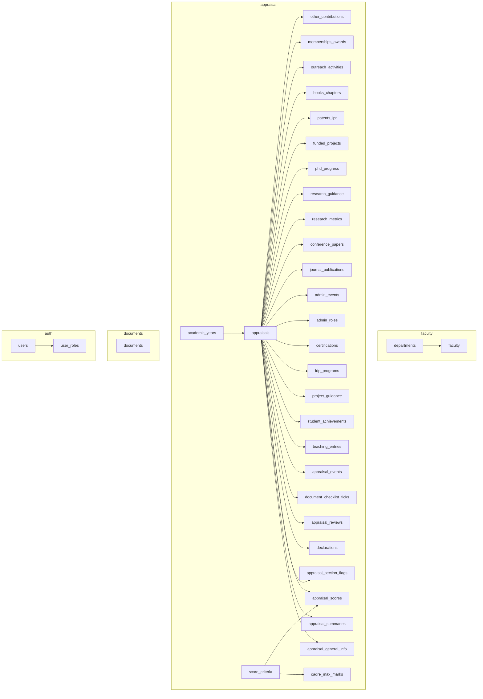

# Database Design (PostgreSQL)

> **PROPOSED.** PostgreSQL, **not** MySQL. Normalised relational tables for repeating appraisal data. **The appraisal is never stored as one giant JSON document.**

Related: [domain-model.md](domain-model.md) · [api-contract.md](api-contract.md) · [service-boundaries.md](service-boundaries.md)

**Verified:** every `sql` block in this document was executed, in order, on a real PostgreSQL engine (PGlite, a WebAssembly build of PostgreSQL): 4 schemas, 35 tables, no errors. The Annexure A integrity query returned zero rows (each cadre = 100 over 9 criteria), and 14 negative probes were rejected as intended (second appraisal for the same faculty + year, two "current" years, bad year label, unknown cadre / indexing / document type / role, pass % > 100, duration end before start, duplicate research-metric platform, a tenth scoring criterion, self-score above max, review role other than HOD/PRINCIPAL). The `version` bump, `updated_at` trigger, score-sheet view and cascade delete were also exercised.

## 1. Decisions

| Topic | Decision | Why |
|---|---|---|
| Engine | PostgreSQL 15+ | required; `gen_random_uuid()` in core, `timestamptz`, partial indexes, `CREATE DOMAIN` |
| Isolation | **One cluster, one schema per service** (`auth`, `faculty`, `appraisal`, `documents`), one DB role per schema | cheap to run now, splittable later |
| Cross-service links | **ids by value, no foreign keys across schemas** (`faculty_id`, `appraisal_id`) | each service can move to its own database |
| Keys | `uuid` primary keys. Repeating rows accept a **client-supplied** uuid (contract rule); the server rejects an id that already belongs to another appraisal | stable ids across autosaves |
| Appraisal identity | `appraisals` is unique on **(faculty_id, academic_year_id)** | requirement |
| Repeating sections | one child table per PDF table, `appraisal_id` FK `ON DELETE CASCADE`, `sort_order` for row order | normalised; queryable; per-column types and checks |
| Enumerations | `CREATE DOMAIN … AS text CHECK (VALUE IN (…))`, one per PDF-closed set | readable, shareable inside a schema, adding a value is a one-line migration, no `ALTER TYPE` limits |
| Status | `text` + `CHECK`; `NOT_STARTED` is **never stored** (no row = not started) | statuses after `SUBMITTED` are PROVISIONAL, so keep them easy to change |
| Numbers | `numeric` for percentages/hours/money, `integer` for counts, with range checks | exact decimals; sanity checks mirror the UI |
| Dates | `date` for dates; month-year stored as `date` = first day of month (API `YYYY-MM`) | native comparison/sorting |
| Concurrency | `appraisals.version`; write with `UPDATE … WHERE id = $1 AND version = $2` | `If-Match` / `412` |
| Nullability | content columns are **nullable**; only keys and bookkeeping are `NOT NULL` | "which fields are required" is a PROVISIONAL UI rule (api-contract §9 #1), so the database must not hard-code it |
| Lengths | contract maxima enforced in the API; add `CHECK (char_length(col) <= n)` once the college confirms limits | avoids freezing guesses |

### JSON policy
`jsonb` is **not used for appraisal content**. It is permitted only for `appraisal_events.metadata` (free-form audit detail), where a fixed schema adds no value.

Why not one document per appraisal: per-column validation and types would be lost; reporting and cross-year queries (e.g. all journal papers by indexing, totals per department) would need JSON path queries; partial updates would rewrite the whole document and widen lost-update windows; schema evolution would need document migration; the PDF is already a set of well-defined tables.

## 2. Entity map



## 3. DDL: `faculty` schema (Faculty Service)

```sql
CREATE SCHEMA faculty;

CREATE TABLE faculty.departments (
  code       text PRIMARY KEY,                 -- CE, ME, ECE_ECT, EEE, CSE_IT, AIML_CAI_DS, BSH, MBA (PDF Part A)
  label      text NOT NULL,                    -- PDF wording: 'ECE / ECT', 'CSE / IT', …
  full_name  text                              -- PROVISIONAL: not in the PDF
);

CREATE TABLE faculty.faculty (
  id                                 uuid PRIMARY KEY DEFAULT gen_random_uuid(),
  user_id                            uuid NOT NULL UNIQUE,      -- auth.users.id (by value)
  employee_id                        varchar(50) UNIQUE,
  name                               varchar(200) NOT NULL,
  email                              varchar(254),
  contact_no                         varchar(30),
  department_code                    text REFERENCES faculty.departments(code),
  cadre                              text CHECK (cadre IN ('LECTURER','ASSISTANT_PROFESSOR','SENIOR_ASSISTANT_PROFESSOR',
                                                           'ASSOCIATE_PROFESSOR','PROFESSOR')),
  highest_qualification              varchar(300),
  phd_status                         text CHECK (phd_status IN ('AWARDED','PURSUING','NOT_APPLICABLE')),
  date_of_joining_institution        date,
  date_of_joining_present_designation date,
  experience_teaching_years          numeric(4,1) CHECK (experience_teaching_years >= 0),
  experience_industry_years          numeric(4,1) CHECK (experience_industry_years >= 0),
  experience_research_years          numeric(4,1) CHECK (experience_research_years >= 0),
  researcher_ids                     varchar(500),
  avatar_url                         text,
  active                             boolean NOT NULL DEFAULT true,
  created_at                         timestamptz NOT NULL DEFAULT now(),
  updated_at                         timestamptz NOT NULL DEFAULT now()
);
CREATE INDEX ix_faculty_department ON faculty.faculty (department_code);
```

## 4. DDL: `appraisal` schema (Appraisal Service)

### 4.1 Domains and reference data

```sql
CREATE SCHEMA appraisal;

CREATE DOMAIN appraisal.cadre_code AS text CHECK (VALUE IN
  ('LECTURER','ASSISTANT_PROFESSOR','SENIOR_ASSISTANT_PROFESSOR','ASSOCIATE_PROFESSOR','PROFESSOR'));
CREATE DOMAIN appraisal.phd_status_code        AS text CHECK (VALUE IN ('AWARDED','PURSUING','NOT_APPLICABLE'));
CREATE DOMAIN appraisal.level_code             AS text CHECK (VALUE IN ('INST','STATE','NAT','INTL'));
CREATE DOMAIN appraisal.conference_level_code  AS text CHECK (VALUE IN ('NAT','INTL'));
CREATE DOMAIN appraisal.project_level_code     AS text CHECK (VALUE IN ('DIPLOMA','UG','PG'));
CREATE DOMAIN appraisal.project_outcome_code   AS text CHECK (VALUE IN ('PAPER','PATENT','PROTOTYPE','COMPETITION'));
CREATE DOMAIN appraisal.program_mode_code      AS text CHECK (VALUE IN ('OFFLINE','ONLINE','BLENDED'));
CREATE DOMAIN appraisal.cert_platform_code     AS text CHECK (VALUE IN ('NPTEL','SWAYAM','COURSERA','OTHER'));
CREATE DOMAIN appraisal.journal_indexing_code  AS text CHECK (VALUE IN ('SCI','SCOPUS','UGC_CARE','ABDC','OTHERS'));
CREATE DOMAIN appraisal.research_platform_code AS text CHECK (VALUE IN ('GOOGLE_SCHOLAR','SCOPUS','WEB_OF_SCIENCE'));
CREATE DOMAIN appraisal.guidance_degree_code   AS text CHECK (VALUE IN ('PHD','MTECH','MBA'));
CREATE DOMAIN appraisal.guidance_status_code   AS text CHECK (VALUE IN ('REGISTERED','SUBMITTED','AWARDED'));
CREATE DOMAIN appraisal.phd_stage_code         AS text CHECK (VALUE IN
  ('COURSE_WORK','COMPREHENSIVE_PROPOSAL','SYNOPSIS_PRE_PHD','THESIS_SUBMITTED','VIVA_VOCE_COMPLETED'));
CREATE DOMAIN appraisal.funded_type_code       AS text CHECK (VALUE IN ('RESEARCH','CONSULTANCY'));
CREATE DOMAIN appraisal.funded_status_code     AS text CHECK (VALUE IN ('SANCTIONED','APPLIED'));
CREATE DOMAIN appraisal.ipr_type_code          AS text CHECK (VALUE IN ('DESIGN','UTILITY','COPYRIGHT'));
CREATE DOMAIN appraisal.ipr_status_code        AS text CHECK (VALUE IN ('FILED','PUBLISHED','GRANTED'));
CREATE DOMAIN appraisal.book_type_code         AS text CHECK (VALUE IN ('BOOK','CHAPTER'));
CREATE DOMAIN appraisal.criterion_code         AS text CHECK (VALUE IN
  ('TEACHING_LEARNING','STUDENT_MENTORING','FDP_CERTIFICATIONS','ADMINISTRATIVE','RESEARCH_PUBLICATIONS',
   'FUNDED_PROJECTS','PATENTS_BOOKS_IPR','OUTREACH','MEMBERSHIPS_AWARDS'));
CREATE DOMAIN appraisal.doc_type_code          AS text CHECK (VALUE IN
  ('COURSE_FILES_RESULT_ANALYSIS','STUDENT_FEEDBACK_REPORTS','MENTORING_RECORDS','PUBLICATION_PROOFS',
   'PROJECT_SANCTION_LETTERS','PATENT_BOOK_PROOFS','FDP_COURSE_CERTIFICATES','ROLE_APPOINTMENT_ORDERS',
   'EVENT_REPORTS','AWARDS_MEMBERSHIP_PROOFS','OTHERS'));
CREATE DOMAIN appraisal.percent_value  AS numeric(5,2) CHECK (VALUE BETWEEN 0 AND 100);   -- UI sanity rule
CREATE DOMAIN appraisal.count_value    AS integer      CHECK (VALUE >= 0);

CREATE TABLE appraisal.academic_years (
  id          uuid PRIMARY KEY DEFAULT gen_random_uuid(),
  label       text NOT NULL UNIQUE CHECK (label ~ '^\d{4}-\d{2}$'),    -- '2025-26'
  is_current  boolean NOT NULL DEFAULT false                          -- PROVISIONAL
);
CREATE UNIQUE INDEX uq_one_current_year ON appraisal.academic_years (is_current) WHERE is_current;

-- Annexure A ---------------------------------------------------------------
CREATE TABLE appraisal.score_criteria (
  code    appraisal.criterion_code PRIMARY KEY,
  number  smallint NOT NULL UNIQUE CHECK (number BETWEEN 1 AND 9),
  title   text NOT NULL
);

CREATE TABLE appraisal.cadre_max_marks (
  cadre      appraisal.cadre_code    NOT NULL,
  criterion  appraisal.criterion_code NOT NULL REFERENCES appraisal.score_criteria(code),
  max_marks  smallint NOT NULL CHECK (max_marks >= 0),
  PRIMARY KEY (cadre, criterion)
);
```

### 4.2 Seed data: criteria and Annexure A (from the PDF)

```sql
INSERT INTO appraisal.score_criteria (code, number, title) VALUES
 ('TEACHING_LEARNING',     1, 'Teaching & Learning'),
 ('STUDENT_MENTORING',     2, 'Student Mentoring, Guidance & Achievements'),
 ('FDP_CERTIFICATIONS',    3, 'FDPs / Certifications'),
 ('ADMINISTRATIVE',        4, 'Administrative, Curriculum & Quality Contributions'),
 ('RESEARCH_PUBLICATIONS', 5, 'Research & Publications'),
 ('FUNDED_PROJECTS',       6, 'Funded Projects / Consultancy'),
 ('PATENTS_BOOKS_IPR',     7, 'Patents, Books & IPR'),
 ('OUTREACH',              8, 'Outreach'),
 ('MEMBERSHIPS_AWARDS',    9, 'Professional Memberships, Awards & Recognitions');

INSERT INTO appraisal.cadre_max_marks (cadre, criterion, max_marks) VALUES
 ('LECTURER','TEACHING_LEARNING',40),('LECTURER','STUDENT_MENTORING',15),('LECTURER','FDP_CERTIFICATIONS',15),
 ('LECTURER','ADMINISTRATIVE',15),('LECTURER','RESEARCH_PUBLICATIONS',5),('LECTURER','FUNDED_PROJECTS',0),
 ('LECTURER','PATENTS_BOOKS_IPR',0),('LECTURER','OUTREACH',5),('LECTURER','MEMBERSHIPS_AWARDS',5),

 ('ASSISTANT_PROFESSOR','TEACHING_LEARNING',30),('ASSISTANT_PROFESSOR','STUDENT_MENTORING',12),('ASSISTANT_PROFESSOR','FDP_CERTIFICATIONS',10),
 ('ASSISTANT_PROFESSOR','ADMINISTRATIVE',15),('ASSISTANT_PROFESSOR','RESEARCH_PUBLICATIONS',15),('ASSISTANT_PROFESSOR','FUNDED_PROJECTS',5),
 ('ASSISTANT_PROFESSOR','PATENTS_BOOKS_IPR',3),('ASSISTANT_PROFESSOR','OUTREACH',5),('ASSISTANT_PROFESSOR','MEMBERSHIPS_AWARDS',5),

 ('SENIOR_ASSISTANT_PROFESSOR','TEACHING_LEARNING',25),('SENIOR_ASSISTANT_PROFESSOR','STUDENT_MENTORING',10),('SENIOR_ASSISTANT_PROFESSOR','FDP_CERTIFICATIONS',8),
 ('SENIOR_ASSISTANT_PROFESSOR','ADMINISTRATIVE',15),('SENIOR_ASSISTANT_PROFESSOR','RESEARCH_PUBLICATIONS',20),('SENIOR_ASSISTANT_PROFESSOR','FUNDED_PROJECTS',7),
 ('SENIOR_ASSISTANT_PROFESSOR','PATENTS_BOOKS_IPR',5),('SENIOR_ASSISTANT_PROFESSOR','OUTREACH',5),('SENIOR_ASSISTANT_PROFESSOR','MEMBERSHIPS_AWARDS',5),

 ('ASSOCIATE_PROFESSOR','TEACHING_LEARNING',20),('ASSOCIATE_PROFESSOR','STUDENT_MENTORING',8),('ASSOCIATE_PROFESSOR','FDP_CERTIFICATIONS',5),
 ('ASSOCIATE_PROFESSOR','ADMINISTRATIVE',15),('ASSOCIATE_PROFESSOR','RESEARCH_PUBLICATIONS',25),('ASSOCIATE_PROFESSOR','FUNDED_PROJECTS',10),
 ('ASSOCIATE_PROFESSOR','PATENTS_BOOKS_IPR',7),('ASSOCIATE_PROFESSOR','OUTREACH',5),('ASSOCIATE_PROFESSOR','MEMBERSHIPS_AWARDS',5),

 ('PROFESSOR','TEACHING_LEARNING',15),('PROFESSOR','STUDENT_MENTORING',5),('PROFESSOR','FDP_CERTIFICATIONS',5),
 ('PROFESSOR','ADMINISTRATIVE',20),('PROFESSOR','RESEARCH_PUBLICATIONS',25),('PROFESSOR','FUNDED_PROJECTS',12),
 ('PROFESSOR','PATENTS_BOOKS_IPR',8),('PROFESSOR','OUTREACH',5),('PROFESSOR','MEMBERSHIPS_AWARDS',5);

-- Migration test: must return ZERO rows (every cadre totals 100, and has exactly 9 criteria)
SELECT cadre FROM appraisal.cadre_max_marks
GROUP BY cadre HAVING SUM(max_marks) <> 100 OR COUNT(*) <> 9;
```

### 4.3 The appraisal and its 1:1 parts

```sql
CREATE TABLE appraisal.appraisals (
  id                uuid PRIMARY KEY DEFAULT gen_random_uuid(),
  faculty_id        uuid NOT NULL,                                   -- faculty.faculty.id (by value)
  academic_year_id  uuid NOT NULL REFERENCES appraisal.academic_years(id),
  status            text NOT NULL DEFAULT 'DRAFT'
                    CHECK (status IN ('DRAFT','SUBMITTED','UNDER_REVIEW','APPROVED','RETURNED','REJECTED')),
                    -- 'NOT_STARTED' is never stored. Only DRAFT and SUBMITTED are certain; the rest PROVISIONAL.
  version           integer NOT NULL DEFAULT 1 CHECK (version >= 1),
  submitted_at      timestamptz,
  created_at        timestamptz NOT NULL DEFAULT now(),
  updated_at        timestamptz NOT NULL DEFAULT now(),
  CONSTRAINT uq_appraisal_faculty_year UNIQUE (faculty_id, academic_year_id)
);

-- Part A: snapshot of the faculty profile, owned by the appraisal.
CREATE TABLE appraisal.appraisal_general_info (
  appraisal_id                        uuid PRIMARY KEY REFERENCES appraisal.appraisals(id) ON DELETE CASCADE,
  faculty_name                        varchar(200),
  employee_id                         varchar(50),
  contact_no                          varchar(30),
  department_code                     text,                           -- by value (Faculty Service reference)
  cadre                               appraisal.cadre_code,           -- drives the maximum marks
  highest_qualification               varchar(300),
  phd_status                          appraisal.phd_status_code,
  date_of_joining_institution         date,
  date_of_joining_present_designation date,
  experience_teaching_years           numeric(4,1) CHECK (experience_teaching_years >= 0),
  experience_industry_years           numeric(4,1) CHECK (experience_industry_years >= 0),
  experience_research_years           numeric(4,1) CHECK (experience_research_years >= 0),
  email                               varchar(254),
  researcher_ids                      varchar(500)
  -- academic year is NOT repeated here: it is the appraisal's academic_year_id
);

-- The PDF's typed totals/counts. PROVISIONAL: typed by faculty, not derived from the rows.
CREATE TABLE appraisal.appraisal_summaries (
  appraisal_id                          uuid PRIMARY KEY REFERENCES appraisal.appraisals(id) ON DELETE CASCADE,
  teaching_total_load_hrs_per_week      numeric(5,2) CHECK (teaching_total_load_hrs_per_week >= 0),
  teaching_average_pass_percent         appraisal.percent_value,
  teaching_average_feedback_percent     appraisal.percent_value,
  mentoring_total_students_mentored     appraisal.count_value,
  journal_count_sci_scie                appraisal.count_value,
  journal_count_scopus                  appraisal.count_value,
  journal_count_ugc_care_abdc           appraisal.count_value,
  journal_count_others                  appraisal.count_value,
  projects_sanctioned_count             appraisal.count_value,
  projects_applied_count                appraisal.count_value,
  projects_total_amount_sanctioned_rs   numeric(14,2) CHECK (projects_total_amount_sanctioned_rs >= 0),
  projects_consultancy_revenue_rs       numeric(14,2) CHECK (projects_consultancy_revenue_rs >= 0),
  patents_filed                         appraisal.count_value,
  patents_published                     appraisal.count_value,
  patents_granted                       appraisal.count_value,
  books_published                       appraisal.count_value,
  book_chapters_published               appraisal.count_value,
  documents_others_specify              text                            -- "Others: ______" of the checklist
);

-- PROVISIONAL UI feature: "nothing to report here". Not in the PDF.
CREATE TABLE appraisal.appraisal_section_flags (
  appraisal_id  uuid NOT NULL REFERENCES appraisal.appraisals(id) ON DELETE CASCADE,
  block_path    text NOT NULL,                                          -- e.g. 'teaching.entries'
  PRIMARY KEY (appraisal_id, block_path)
);

CREATE TABLE appraisal.other_contributions (          -- B10: two free-text areas, not a table, not scored
  appraisal_id      uuid PRIMARY KEY REFERENCES appraisal.appraisals(id) ON DELETE CASCADE,
  department_level  text,
  institute_level   text
);

CREATE TABLE appraisal.declarations (                 -- mechanism PROVISIONAL (PDF: Date, Place, Signature of Faculty)
  appraisal_id  uuid PRIMARY KEY REFERENCES appraisal.appraisals(id) ON DELETE CASCADE,
  declared_on   date,
  place         varchar(200),
  signature     varchar(200),                           -- typed name as digital stand-in
  recorded_at   timestamptz NOT NULL DEFAULT now()
);
```

### 4.4 Repeating sections (one table per PDF table)

Every table has `id uuid PRIMARY KEY` (client-supplied), `appraisal_id … ON DELETE CASCADE`, `sort_order`, and an index on `(appraisal_id, sort_order)`. Content columns are nullable (see §1, Nullability).

```sql
-- B1 Teaching
CREATE TABLE appraisal.teaching_entries (
  id uuid PRIMARY KEY,
  appraisal_id uuid NOT NULL REFERENCES appraisal.appraisals(id) ON DELETE CASCADE,
  sort_order integer NOT NULL,
  course_code_name text, program_branch text, semester text,
  num_sections appraisal.count_value,
  hours_per_week numeric(5,2) CHECK (hours_per_week >= 0),
  pass_percent appraisal.percent_value,
  phase1_feedback_percent appraisal.percent_value,
  phase2_feedback_percent appraisal.percent_value
);

-- B2 Mentoring
CREATE TABLE appraisal.student_achievements (
  id uuid PRIMARY KEY,
  appraisal_id uuid NOT NULL REFERENCES appraisal.appraisals(id) ON DELETE CASCADE,
  sort_order integer NOT NULL,
  student_name_roll_no text, achievement text,
  level appraisal.level_code,
  month_year date                                    -- first day of the month
);
CREATE TABLE appraisal.project_guidance (
  id uuid PRIMARY KEY,
  appraisal_id uuid NOT NULL REFERENCES appraisal.appraisals(id) ON DELETE CASCADE,
  sort_order integer NOT NULL,
  level appraisal.project_level_code, project_title text,
  num_students appraisal.count_value, outcome appraisal.project_outcome_code
);

-- B3 FDPs / Certifications
CREATE TABLE appraisal.fdp_programs (
  id uuid PRIMARY KEY,
  appraisal_id uuid NOT NULL REFERENCES appraisal.appraisals(id) ON DELETE CASCADE,
  sort_order integer NOT NULL,
  title text, mode appraisal.program_mode_code, organizer_venue text,
  duration_from date, duration_to date, num_days appraisal.count_value,
  CHECK (duration_to IS NULL OR duration_from IS NULL OR duration_to >= duration_from)
);
CREATE TABLE appraisal.certifications (
  id uuid PRIMARY KEY,
  appraisal_id uuid NOT NULL REFERENCES appraisal.appraisals(id) ON DELETE CASCADE,
  sort_order integer NOT NULL,
  platform appraisal.cert_platform_code, course_title text,
  duration_from date, duration_to date, duration_weeks_hours text, grade_score text,
  CHECK (duration_to IS NULL OR duration_from IS NULL OR duration_to >= duration_from)
);

-- B4 Administrative (two scopes share one table; the API exposes two lists)
CREATE TABLE appraisal.admin_roles (
  id uuid PRIMARY KEY,
  appraisal_id uuid NOT NULL REFERENCES appraisal.appraisals(id) ON DELETE CASCADE,
  scope text NOT NULL CHECK (scope IN ('INSTITUTE','DEPARTMENT')),
  sort_order integer NOT NULL,
  role text, responsibility text, period text         -- period format PROVISIONAL
);
CREATE TABLE appraisal.admin_events (
  id uuid PRIMARY KEY,
  appraisal_id uuid NOT NULL REFERENCES appraisal.appraisals(id) ON DELETE CASCADE,
  sort_order integer NOT NULL,
  activity_type text, role text, title_details text,
  duration_from date, duration_to date, num_beneficiaries appraisal.count_value,
  CHECK (duration_to IS NULL OR duration_from IS NULL OR duration_to >= duration_from)
);

-- B5 Research & Publications
CREATE TABLE appraisal.journal_publications (
  id uuid PRIMARY KEY,
  appraisal_id uuid NOT NULL REFERENCES appraisal.appraisals(id) ON DELETE CASCADE,
  sort_order integer NOT NULL,
  title text,                                         -- includes the author-position mark (PDF)
  journal_name text, vol_issue_page text, month_year date,
  indexing appraisal.journal_indexing_code, doi_issn text
);
CREATE TABLE appraisal.conference_papers (
  id uuid PRIMARY KEY,
  appraisal_id uuid NOT NULL REFERENCES appraisal.appraisals(id) ON DELETE CASCADE,
  sort_order integer NOT NULL,
  title text, conference_name text, level appraisal.conference_level_code, month_year date,
  venue text, doi_indexed_in text, num_citations appraisal.count_value
);
CREATE TABLE appraisal.research_metrics (              -- B5(c): one row per platform, max 3
  appraisal_id uuid NOT NULL REFERENCES appraisal.appraisals(id) ON DELETE CASCADE,
  platform appraisal.research_platform_code NOT NULL,
  total_publications appraisal.count_value, total_citations appraisal.count_value,
  h_index appraisal.count_value, i10_index appraisal.count_value,
  PRIMARY KEY (appraisal_id, platform)
);
CREATE TABLE appraisal.research_guidance (             -- B5(d)(i)
  id uuid PRIMARY KEY,
  appraisal_id uuid NOT NULL REFERENCES appraisal.appraisals(id) ON DELETE CASCADE,
  sort_order integer NOT NULL,
  scholar_name text, degree appraisal.guidance_degree_code, university_reg_no text,
  status appraisal.guidance_status_code, year text
);
CREATE TABLE appraisal.phd_progress (                  -- B5(d)(ii): own Ph.D. progress (if pursuing)
  appraisal_id uuid PRIMARY KEY REFERENCES appraisal.appraisals(id) ON DELETE CASCADE,
  university_center text, year_of_registration text,
  current_stage appraisal.phd_stage_code, progress_during_year text
);

-- B6 Funded projects / consultancy
CREATE TABLE appraisal.funded_projects (
  id uuid PRIMARY KEY,
  appraisal_id uuid NOT NULL REFERENCES appraisal.appraisals(id) ON DELETE CASCADE,
  sort_order integer NOT NULL,
  title text, role_team text, type appraisal.funded_type_code, funding_agency_client text,
  amount_rs numeric(14,2) CHECK (amount_rs >= 0),
  duration_from date, duration_to date, status appraisal.funded_status_code, year text,
  CHECK (duration_to IS NULL OR duration_from IS NULL OR duration_to >= duration_from)
);

-- B7 Patents, books & IPR
CREATE TABLE appraisal.patents_ipr (
  id uuid PRIMARY KEY,
  appraisal_id uuid NOT NULL REFERENCES appraisal.appraisals(id) ON DELETE CASCADE,
  sort_order integer NOT NULL,
  applicants_inventors text, title_application_no text,
  type appraisal.ipr_type_code, status appraisal.ipr_status_code, event_date date
);
CREATE TABLE appraisal.books_chapters (
  id uuid PRIMARY KEY,
  appraisal_id uuid NOT NULL REFERENCES appraisal.appraisals(id) ON DELETE CASCADE,
  sort_order integer NOT NULL,
  authors text, title text, publisher text, isbn text, month_year date, type appraisal.book_type_code
);

-- B8 Outreach, B9 Memberships / Awards
CREATE TABLE appraisal.outreach_activities (
  id uuid PRIMARY KEY,
  appraisal_id uuid NOT NULL REFERENCES appraisal.appraisals(id) ON DELETE CASCADE,
  sort_order integer NOT NULL,
  role text,                                           -- free text; the PDF's 11 roles are suggestions
  event_activity text, organization text, venue text, activity_date date
);
CREATE TABLE appraisal.memberships_awards (
  id uuid PRIMARY KEY,
  appraisal_id uuid NOT NULL REFERENCES appraisal.appraisals(id) ON DELETE CASCADE,
  sort_order integer NOT NULL,
  name text, body text, level appraisal.level_code, year text
);

-- one index per child list, e.g.
CREATE INDEX ix_teaching_entries_appraisal        ON appraisal.teaching_entries        (appraisal_id, sort_order);
CREATE INDEX ix_student_achievements_appraisal    ON appraisal.student_achievements    (appraisal_id, sort_order);
CREATE INDEX ix_project_guidance_appraisal        ON appraisal.project_guidance        (appraisal_id, sort_order);
CREATE INDEX ix_fdp_programs_appraisal            ON appraisal.fdp_programs            (appraisal_id, sort_order);
CREATE INDEX ix_certifications_appraisal          ON appraisal.certifications          (appraisal_id, sort_order);
CREATE INDEX ix_admin_roles_appraisal             ON appraisal.admin_roles             (appraisal_id, scope, sort_order);
CREATE INDEX ix_admin_events_appraisal            ON appraisal.admin_events            (appraisal_id, sort_order);
CREATE INDEX ix_journal_publications_appraisal    ON appraisal.journal_publications    (appraisal_id, sort_order);
CREATE INDEX ix_conference_papers_appraisal       ON appraisal.conference_papers       (appraisal_id, sort_order);
CREATE INDEX ix_research_guidance_appraisal       ON appraisal.research_guidance       (appraisal_id, sort_order);
CREATE INDEX ix_funded_projects_appraisal         ON appraisal.funded_projects         (appraisal_id, sort_order);
CREATE INDEX ix_patents_ipr_appraisal             ON appraisal.patents_ipr             (appraisal_id, sort_order);
CREATE INDEX ix_books_chapters_appraisal          ON appraisal.books_chapters          (appraisal_id, sort_order);
CREATE INDEX ix_outreach_activities_appraisal     ON appraisal.outreach_activities     (appraisal_id, sort_order);
CREATE INDEX ix_memberships_awards_appraisal      ON appraisal.memberships_awards      (appraisal_id, sort_order);
```

### 4.5 Supporting-document ticks, scores, reviews, activity

```sql
-- "Supporting documents enclosed": the ticks (files live in the documents schema)
CREATE TABLE appraisal.document_checklist_ticks (
  appraisal_id   uuid NOT NULL REFERENCES appraisal.appraisals(id) ON DELETE CASCADE,
  document_type  appraisal.doc_type_code NOT NULL,
  PRIMARY KEY (appraisal_id, document_type)
);

-- Score sheet. Backend-owned. PDF defines maximum marks only; NO formula.
CREATE TABLE appraisal.appraisal_scores (
  appraisal_id  uuid NOT NULL REFERENCES appraisal.appraisals(id) ON DELETE CASCADE,
  criterion     appraisal.criterion_code NOT NULL REFERENCES appraisal.score_criteria(code),
  max_marks     smallint NOT NULL CHECK (max_marks >= 0),      -- COPIED from cadre_max_marks when scored (history-safe)
  self_score    numeric(5,2) CHECK (self_score >= 0),          -- NULL until the backend supplies it
  PRIMARY KEY (appraisal_id, criterion),
  CHECK (self_score IS NULL OR self_score <= max_marks)        -- sanity check; PROVISIONAL
);
-- Totals are derived, never stored:
CREATE VIEW appraisal.v_score_sheet AS
SELECT s.appraisal_id,
       SUM(s.max_marks)  AS max_score,
       CASE WHEN COUNT(s.self_score) = COUNT(*) THEN SUM(s.self_score) END AS self_score
FROM appraisal.appraisal_scores s GROUP BY s.appraisal_id;

-- HoD and Principal. PROVISIONAL workflow.
CREATE TABLE appraisal.appraisal_reviews (
  appraisal_id      uuid NOT NULL REFERENCES appraisal.appraisals(id) ON DELETE CASCADE,
  role              text NOT NULL CHECK (role IN ('HOD','PRINCIPAL')),
  remarks           text,
  reviewer_name     varchar(200),              -- "Signature with Seal & Date": digital form undefined
  reviewer_user_id  uuid,                      -- auth.users.id (by value)
  signed_on         date,
  recorded_at       timestamptz NOT NULL DEFAULT now(),
  PRIMARY KEY (appraisal_id, role)
);

-- Audit trail used by the dashboard timeline. PROVISIONAL.
CREATE TABLE appraisal.appraisal_events (
  id            uuid PRIMARY KEY DEFAULT gen_random_uuid(),
  appraisal_id  uuid NOT NULL REFERENCES appraisal.appraisals(id) ON DELETE CASCADE,
  event_type    text NOT NULL,                 -- STARTED, SAVED, SUBMITTED, DOCUMENT_ADDED, …
  message       text NOT NULL,
  actor_user_id uuid,
  metadata      jsonb,                         -- the ONLY jsonb column; free-form audit detail
  created_at    timestamptz NOT NULL DEFAULT now()
);
CREATE INDEX ix_appraisal_events_appraisal ON appraisal.appraisal_events (appraisal_id, created_at DESC);

-- keep updated_at honest
CREATE FUNCTION appraisal.touch_updated_at() RETURNS trigger LANGUAGE plpgsql AS
$$ BEGIN NEW.updated_at := now(); RETURN NEW; END $$;
CREATE TRIGGER trg_appraisals_touch BEFORE UPDATE ON appraisal.appraisals
  FOR EACH ROW EXECUTE FUNCTION appraisal.touch_updated_at();
```

## 5. DDL: `documents` schema (Document Service)

```sql
CREATE SCHEMA documents;
CREATE TABLE documents.documents (
  id              uuid PRIMARY KEY DEFAULT gen_random_uuid(),
  appraisal_id    uuid NOT NULL,                       -- appraisal.appraisals.id (by value)
  faculty_id      uuid NOT NULL,                       -- owner (by value)
  academic_year   text NOT NULL,                       -- denormalised so listing needs no call to the Appraisal Service
  document_type   text NOT NULL CHECK (document_type IN
    ('COURSE_FILES_RESULT_ANALYSIS','STUDENT_FEEDBACK_REPORTS','MENTORING_RECORDS','PUBLICATION_PROOFS',
     'PROJECT_SANCTION_LETTERS','PATENT_BOOK_PROOFS','FDP_COURSE_CERTIFICATES','ROLE_APPOINTMENT_ORDERS',
     'EVENT_REPORTS','AWARDS_MEMBERSHIP_PROOFS','OTHERS')),
  file_name       text NOT NULL,
  content_type    text,
  size_bytes      bigint NOT NULL CHECK (size_bytes > 0),
  storage_key     text NOT NULL UNIQUE,                -- location in object/file storage; the file is NOT in the database
  checksum_sha256 char(64),
  uploaded_by     uuid NOT NULL,
  uploaded_at     timestamptz NOT NULL DEFAULT now(),
  deleted_at      timestamptz                          -- soft delete; storage cleaned up later
);
CREATE INDEX ix_documents_appraisal ON documents.documents (appraisal_id) WHERE deleted_at IS NULL;
CREATE INDEX ix_documents_faculty   ON documents.documents (faculty_id, academic_year) WHERE deleted_at IS NULL;
```

## 6. DDL: `auth` schema (Auth Service), minimal

```sql
CREATE SCHEMA auth;
CREATE TABLE auth.users (
  id            uuid PRIMARY KEY DEFAULT gen_random_uuid(),
  login         varchar(254) NOT NULL UNIQUE,          -- e-mail or employee id; sign-in method is an open question
  password_hash text,                                  -- NULL if the college uses SSO (open question)
  active        boolean NOT NULL DEFAULT true,
  created_at    timestamptz NOT NULL DEFAULT now()
);
CREATE TABLE auth.user_roles (
  user_id uuid NOT NULL REFERENCES auth.users(id) ON DELETE CASCADE,
  role    text NOT NULL CHECK (role IN ('FACULTY','HOD','PRINCIPAL')),   -- 'ADMIN' is PROVISIONAL
  PRIMARY KEY (user_id, role)
);
```

## 7. API → table mapping

| Contract path | Table (column group) |
|---|---|
| `AppraisalDto` envelope | `appraisal.appraisals` |
| `generalInfo` | `appraisal_general_info` (+ `academicYear` from `academic_years.label` via the appraisal) |
| `teaching.entries[]` | `teaching_entries` |
| `teaching.summary` | `appraisal_summaries.teaching_*` |
| `mentoring.summary` | `appraisal_summaries.mentoring_total_students_mentored` |
| `mentoring.achievements[]` / `projectsGuided[]` | `student_achievements` / `project_guidance` |
| `fdp.programs[]` / `certifications[]` | `fdp_programs` / `certifications` |
| `administrative.instituteRoles[]` / `departmentRoles[]` | `admin_roles` with `scope = INSTITUTE` / `DEPARTMENT` |
| `administrative.events[]` | `admin_events` |
| `research.journalCounts` | `appraisal_summaries.journal_count_*` |
| `research.journals[]` / `conferences[]` | `journal_publications` / `conference_papers` |
| `research.metrics[]` | `research_metrics` (one row per platform) |
| `research.guidance[]` / `ownPhd` | `research_guidance` / `phd_progress` |
| `fundedProjects.summary` / `entries[]` | `appraisal_summaries.projects_*` / `funded_projects` |
| `ipr.patentSummary` / `patents[]` | `appraisal_summaries.patents_*` / `patents_ipr` |
| `ipr.bookSummary` / `books[]` | `appraisal_summaries.book*` / `books_chapters` |
| `outreach.activities[]` | `outreach_activities` |
| `membershipsAwards.entries[]` | `memberships_awards` |
| `otherContributions` | `other_contributions` |
| `supportingDocuments.enclosed` / `othersSpecify` | `document_checklist_ticks` / `appraisal_summaries.documents_others_specify` |
| `declaration` | `declarations` |
| `nothingToReport[]` | `appraisal_section_flags` |
| `scoreSheet` (read-only) | `appraisal_scores` + `v_score_sheet` |
| `reviews.hod` / `reviews.principal` (read-only) | `appraisal_reviews` (`role`) |
| `GET /appraisals/{id}/activity` | `appraisal_events` |
| `DocumentDto` | `documents.documents` |
| `FacultyProfileDto` | `faculty.faculty` + `faculty.departments` |

## 8. Write algorithm for `PATCH /appraisals/{id}` (one transaction)

1. `SELECT … FROM appraisals WHERE id = $1 FOR UPDATE`; check ownership; if status is locked → `409`; if `version <> If-Match` → `412`.
2. For each section in the body: validate against the DTO rules; then
   - **single objects** (`generalInfo`, summaries, `ownPhd`, `otherContributions`, `declaration`): upsert the row (summaries update only their own columns);
   - **lists**: upsert rows by `id` (reject an `id` that belongs to another appraisal), set `sort_order` from array position, delete rows of that list not in the array;
   - **`research.metrics`**: delete-and-insert by `platform`;
   - **`supportingDocuments`**: replace the tick rows and set `documents_others_specify`;
   - **`nothingToReport`**: replace the flag rows.
3. `UPDATE appraisals SET version = version + 1` (the trigger sets `updated_at`), append an `appraisal_events` row, commit, return the full `AppraisalDto`.

`POST /submit` repeats the lock/ownership checks, runs submission validation (provisional), sets `status = 'SUBMITTED'`, `submitted_at = now()`, bumps `version`.

## 9. Operational notes

| Topic | Note |
|---|---|
| Migrations | versioned, forward-only (tool-neutral). Seeds for departments, criteria, cadre maxima, document types live in migrations |
| Test | the Annexure A integrity query in §4.2 must return zero rows in CI |
| Privileges | each service role has rights on its own schema only; reporting access via a read-only role |
| Backups | daily full + WAL archiving; documents' files are backed up with the object/file store, not the database |
| Retention | how long appraisals and files are kept is **not defined** by the PDF (open question) |
| Soft vs hard delete | appraisal data is not deleted by the API; documents are soft-deleted |
| Reporting | the normalised model supports queries such as "all journal papers per indexing per department" directly |
