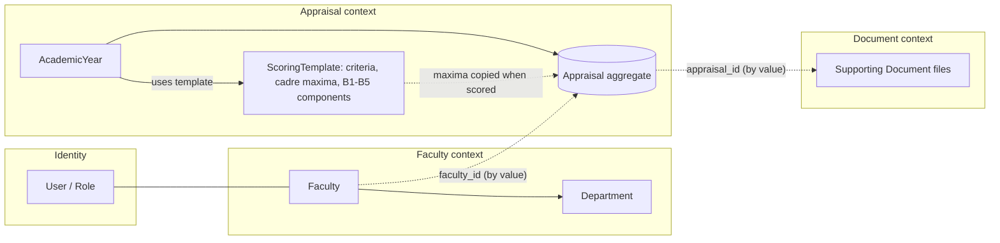
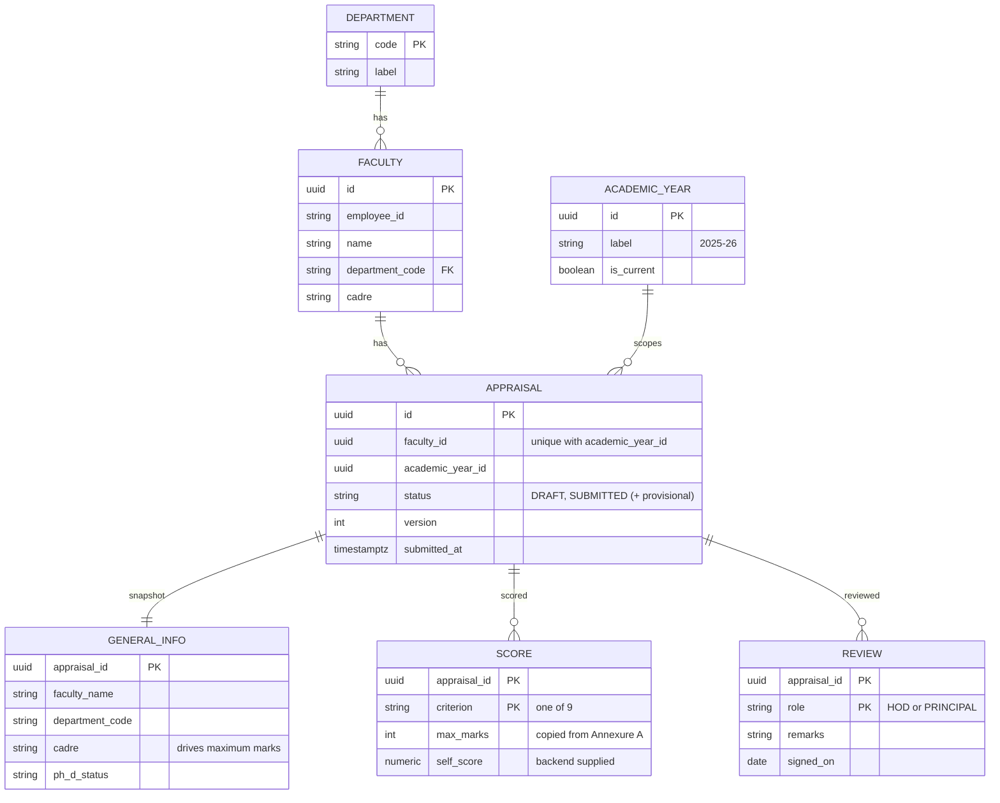
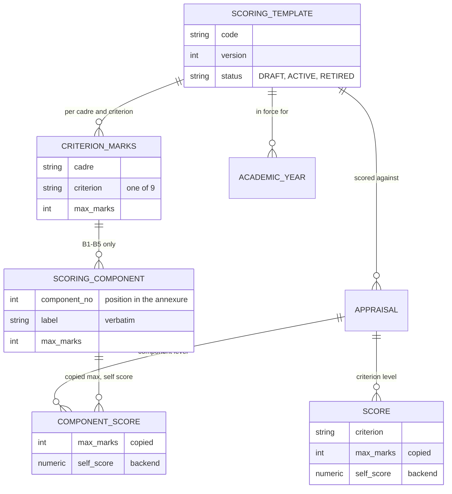

# Domain Model

> **PROPOSED.** The domain follows the **PDF's business structure**, not the UI's 16 steps. A step is a screen; an entity is something the college keeps records about.

Related: [api-contract.md](api-contract.md) · [database-design.md](database-design.md) · [service-boundaries.md](service-boundaries.md)

## 1. Principles

1. **One aggregate: `Appraisal`.** Everything the faculty fills in (Part A, Part B 1–10, the supporting-documents ticks, the declaration) and everything done to it afterwards (score sheet, HoD and Principal reviews) belongs to one appraisal, which belongs to **one faculty and one academic year**.
2. **Repeating PDF tables are child entities.** Each repeating table in the PDF is its own list of rows under the appraisal.
3. **Part A is a snapshot.** It is prefilled from the Faculty profile when the appraisal is created and then owned by the appraisal, so history does not change when a profile does.
4. **Scores are backend facts, structured as criterion → component.** The PDFs define the nine criteria, the cadre-wise maximum marks and, for B1 to B5, the maximum marks of each scoring **component**, but **no formula** for turning evidence into a score. The backend owns `maxScore`, `selfScore` and component self-scores; no formula is modelled here.
5. **Scoring rules are versioned.** Criteria, cadre maxima and components belong to a `ScoringTemplate` (a version), assigned per academic year, so the rules can change without touching past appraisals.
6. **UI steps are not entities.** HoD / Principal "steps", "Review & Submit" and the stepper have no tables of their own.
7. **Provisional things are flagged, not invented.** Review workflow, submission rules and statuses beyond `DRAFT` / `SUBMITTED` are placeholders until the college confirms them.

## 2. Context map

Contexts reference each other **by id value**, never by database foreign key, so each can become its own service without a rewrite.

## 3. Entity overview

```mermaid
erDiagram
  DEPARTMENT ||--o{ FACULTY : "belongs to"
  FACULTY ||--o{ APPRAISAL : "has one per year"
  ACADEMIC_YEAR ||--o{ APPRAISAL : "scopes"
  APPRAISAL ||--|| GENERAL_INFO : "Part A snapshot"
  APPRAISAL ||--|| SUMMARY_COUNTS : "typed totals"
  APPRAISAL ||--o{ SECTION_FLAG : "nothing to report (provisional)"
  APPRAISAL ||--o{ SCORE : "9 criterion rows"
  APPRAISAL ||--o{ COMPONENT_SCORE : "B1-B5 component rows"
  SCORING_TEMPLATE ||--o{ ACADEMIC_YEAR : "in force for"
  SCORING_TEMPLATE ||--o{ APPRAISAL : "scored against"
  APPRAISAL ||--o| DECLARATION : "signed once"
  APPRAISAL ||--o{ REVIEW : "HOD and PRINCIPAL"
  APPRAISAL ||--o{ DOCUMENT_CHECKLIST_TICK : "enclosed items"
  APPRAISAL ||--o{ SUPPORTING_DOCUMENT : "files"
  APPRAISAL ||--o{ TEACHING_ENTRY : ""
  APPRAISAL ||--o{ STUDENT_ACHIEVEMENT : ""
  APPRAISAL ||--o{ PROJECT_GUIDANCE : ""
  APPRAISAL ||--o{ FDP : ""
  APPRAISAL ||--o{ CERTIFICATION : ""
  APPRAISAL ||--o{ ADMIN_ROLE : "institute or department"
  APPRAISAL ||--o{ ADMIN_EVENT : ""
  APPRAISAL ||--o{ JOURNAL_PUBLICATION : ""
  APPRAISAL ||--o{ CONFERENCE_PAPER : ""
  APPRAISAL ||--o{ RESEARCH_METRIC : "max 3, one per platform"
  APPRAISAL ||--o{ RESEARCH_GUIDANCE : ""
  APPRAISAL ||--o| PHD_PROGRESS : "if pursuing"
  APPRAISAL ||--o{ FUNDED_PROJECT : ""
  APPRAISAL ||--o{ PATENT_IPR : ""
  APPRAISAL ||--o{ BOOK_CHAPTER : ""
  APPRAISAL ||--o{ OUTREACH_ACTIVITY : ""
  APPRAISAL ||--o{ MEMBERSHIP_AWARD : ""
  APPRAISAL ||--o| OTHER_CONTRIBUTION : "two free-text areas"
```

### Appraisal and its identity

## 4. Entities and their PDF origin

| Entity | Kind | PDF origin | Cardinality under an appraisal | Source / owner |
|---|---|---|---|---|
| **Faculty** | root (Faculty context) | Part A identity fields | n/a | [P], Faculty Service |
| **Department** | reference | Part A "Department / Branch" (8 options) | n/a | Faculty Service |
| **AcademicYear** | reference | Part A "Academic Year" | n/a | Appraisal Service |
| **Appraisal** | aggregate root | the whole report | one per (faculty, academic year) | [A], Appraisal Service |
| GeneralInfo | child, 1:1 | Part A | 1 | [P→A] snapshot |
| SummaryCounts | child, 1:1 | typed totals: teaching totals, students mentored, journal counts, project summary, patent summary, book counts | 1 | [A], **PROVISIONAL typed** |
| **Teaching Entry** | child list | B1 "Courses handled during the Academic Year" | 0..n | [A] |
| **Student Achievement** | child list | B2 "Student achievements" | 0..n | [A] |
| **Project Guidance** | child list | B2(b) "Student projects guided" | 0..n | [A] |
| **FDP** | child list | B3(a) Workshops / FDPs / Seminars / Training | 0..n | [A] |
| **Certification** | child list | B3(b) Certifications | 0..n | [A] |
| **Administrative Role** | child list with `scope` = `INSTITUTE` or `DEPARTMENT` | B4(a) and B4(b) (identical columns, one entity) | 0..n each | [A] |
| **Administrative Event** | child list | B4(c) events / workshops / tours / trainings / guest lectures organised | 0..n | [A] |
| **Journal Publication** | child list | B5(a) | 0..n | [A] |
| **Conference Paper** | child list | B5(b) | 0..n | [A] |
| **Research Metric** | child list, unique per platform | B5(c) Research profile metrics | 0..3 | [A] |
| **Research Guidance** | child list | B5(d)(i) scholars / PG dissertations | 0..n | [A] |
| **PhD Progress** | child, 0..1 | B5(d)(ii) Own Ph.D. progress (if pursuing) | 0..1 | [A] |
| **Funded Project** | child list | B6 | 0..n | [A] |
| **Patent / IPR** | child list | B7(a) | 0..n | [A] |
| **Book / Chapter** | child list | B7(b) | 0..n | [A] |
| **Outreach Activity** | child list | B8 | 0..n | [A] |
| **Membership / Award** | child list | B9 | 0..n | [A] |
| **Other Contribution** | child, 1:1 | B10 two free-text areas (Department / Institute level). **Not scored** | 0..1 | [A] |
| **Score** | child, exactly 9 once scored | B11 score sheet. Criterion rows with maximum marks from Annexure A | 0 or 9 | [S] backend |
| **ComponentScore** | child, only for B1 to B5 | scoring annexure: component rows under criteria B1 to B5, each with a copied maximum and a backend-supplied self-score. **No breakdown exists for B6 to B9** | 0 or 21 (Asst. Prof.; 19 to 21 by cadre) | [S] backend |
| **Supporting Document** | separate context | B11 "Supporting documents enclosed" (11 types). Files | 0..n | Document Service |
| DocumentChecklistTick | child | the ticks of the same checklist, plus "Others: ____" text | 0..11 | [A] |
| **Declaration** | child, 0..1 | Declaration: Date, Place, Signature of Faculty. **Mechanism PROVISIONAL** | 0..1 | [A] |
| **HOD Review** | child (`Review`, role `HOD`) | "Recommendations of HoD" + "Head of the Department (Signature with Seal & Date)". **PROVISIONAL workflow** | 0..1 | [R] |
| **Principal Review** | child (`Review`, role `PRINCIPAL`) | "Remarks of the Principal" + "Principal (Signature with Seal & Date)". **PROVISIONAL workflow** | 0..1 | [R] |
| SectionFlag | child (**PROVISIONAL UI feature**) | not in the PDF: "nothing to report" per section | 0..n | [A] |
| **ScoringTemplate** | reference, versioned | the rule set: Annexure A + scoring annexure B1 to B5. Assigned per academic year; an appraisal remembers the one it was created under | n/a | Appraisal Service (seeded) |
| ScoreCriterion | reference | the nine criteria (no tenth) | 9 | Appraisal Service (seeded) |
| CriterionMarks | reference (per template) | Annexure A: maximum marks per cadre and criterion | 5 cadres × 9 criteria | Appraisal Service (seeded) |
| **ScoringComponent** | reference (per template) | scoring annexure: component label and maximum marks per cadre, B1 to B5 only | 102 across 5 cadres; 0 for B6 to B9 | Appraisal Service (seeded) |
| User, Role | identity | not in the PDF | | Auth Service |

Two modelling choices worth stating:
- **`Administrative Role` is one entity with a `scope`**, because "(a) Institute level roles" and "(b) Department level roles" have identical columns. The API still exposes them as two lists (`instituteRoles`, `departmentRoles`), matching the two PDF tables.
- **HOD Review and Principal Review are one `Review` entity with a `role`**: same shape (remarks, signer, date), two instances per appraisal at most.

## 5. Invariants

| # | Invariant | Status |
|---|---|---|
| 1 | At most one appraisal per (faculty, academic year) | firm (stated by the requirement) |
| 2 | An appraisal's `cadre` is a snapshot and is one of the 5 PDF cadres | firm |
| 3 | A scored appraisal has exactly 9 `Score` rows, one per criterion; `max_marks` come from the appraisal's template for the snapshot cadre; each cadre's maxima sum to 100 | firm (Annexure A) |
| 4 | There is no 10th criterion; "Any Other Contributions" never has a score row | firm (PDF) |
| 5 | `self_score` (criterion and component) is never calculated by the frontend. The backend supplies it by a mechanism the documents do not define | **PROVISIONAL** |
| 5a | Within a template, a cadre's components for a criterion add up to that criterion's maximum, wherever components exist (B1 to B5) | firm (scoring annexure, checked for all 25 pairs) |
| 5b | Components exist only for B1 to B5. B6 to B9 have none; a component total is therefore **not** comparable with the 100 total | firm for the current annexure |
| 5c | A criterion's self-score is **not** assumed to equal the sum of its components | **REQUIRES COLLEGE CONFIRMATION** |
| 5d | An appraisal keeps the scoring template it was created under; a rule change is a new template version, never an edit of an ACTIVE one | proposed policy |
| 6 | `Research Metric` has at most one row per platform (3) | firm (PDF grid) |
| 7 | A `Review` exists at most once per role per appraisal | firm |
| 8 | A submitted appraisal is read-only for the faculty | `SUBMITTED` lock is firm for the UI; statuses beyond it are **PROVISIONAL** |
| 9 | Row `id`s are client-generated UUIDs and stable across saves | contract rule |
| 10 | Writes are guarded by an optimistic version | contract rule |

## 6. UI step → domain part (the steps are not entities)

| UI step | Domain part |
|---|---|
| 1 General Information | `GeneralInfo` |
| 2 Teaching & Learning | `TeachingEntry` list + teaching totals (`SummaryCounts`) |
| 3 Student Mentoring, Project Guidance & Achievements | `StudentAchievement`, `ProjectGuidance`, students-mentored total |
| 4 FDPs / Certifications | `Fdp`, `Certification` |
| 5 Administrative Responsibilities | `AdminRole` (×2 scopes), `AdminEvent` |
| 6 Research & Publications | `JournalPublication` (+ counts), `ConferencePaper`, `ResearchMetric`, `ResearchGuidance`, `PhdProgress` |
| 7 Funded Projects / Consultancy | `FundedProject` (+ summary) |
| 8 Patents, Books & IPR | `PatentIpr` (+ summary), `BookChapter` (+ counts) |
| 9 Outreach | `OutreachActivity` |
| 10 Professional Memberships, Awards & Recognitions | `MembershipAward` |
| 11 Any Other Contributions | `OtherContribution` |
| 12 Score Sheet & Supporting Documents | `Score` (read-only), `DocumentChecklistTick`, `SupportingDocument` |
| 13 Declaration | `Declaration` |
| 14 Recommendations of HoD | `Review(HOD)` (read-only for faculty) |
| 15 Remarks of the Principal | `Review(PRINCIPAL)` (read-only for faculty) |
| 16 Review & Submit | **no entity**: UI-only; triggers the `DRAFT → SUBMITTED` transition |

## 7. What is deliberately not modelled

- A scoring formula or rule engine. The documents give maximum marks (criterion and component) but no way to turn evidence into a score; this is REQUIRES COLLEGE CONFIRMATION.
- An approval / review workflow engine, queues, delegation, return reasons (undefined by the PDF).
- Per-row evidence attachments (the first build had them; the PDF does not).
- Full department names, academic-year start/end dates, appraisal windows (not in the PDF).

## 8. Scoring Annexure: B1 to B5

The score sheet used to be modelled as `Criterion → Maximum → Self-score`. The scoring annexure adds a level:

Conceptual chain, as requested: `ScoringTemplate → Cadre → Criterion → ScoringComponent → MaximumMarks`, and on the appraisal side `Appraisal → SelfScore / ComponentSelfScore`.

### CONFIRMED FROM THE SCORING ANNEXURE
- B1 Teaching & Learning, B2 Student Mentoring, Guidance & Achievements, B3 FDPs / Certifications, B4 Administrative, Curriculum & Quality Contributions and B5 Research & Publications are each divided into components with a maximum mark, **separately for each of the five cadres**.
- For every cadre and criterion the components add up to the criterion maximum from Annexure A (all 25 pairs checked; 102 components in total).
- The set, number and wording of components differ by cadre (for example Lecturer B5 has 3 components, Assistant Professor B5 has 5, Professor B2 has 3). A component is identified by its position within the cadre's list, and **similarly named components of different cadres are not assumed to be the same thing**.
- Complete tables: [api-contract.md §3](api-contract.md#3-scoring-reference).

### REQUIRES COLLEGE CONFIRMATION
- **The scoring rules themselves.** How evidence (pass %, feedback, number of publications, FDP counts …) becomes a component score is not defined. No formula, threshold, weight or automatic rule is modelled.
- Who supplies component self-scores (faculty, panel or system) and at what point.
- Whether a criterion self-score equals the sum of its component scores (the model deliberately does not enforce it).
- **B6 to B9** (Funded Projects / Consultancy, Patents, Books & IPR, Outreach, Professional Memberships, Awards & Recognitions): only the criterion maximum is defined (Annexure A). They have no components, and their detailed scoring methodology is not defined.
- Which academic years the current template applies to.

### Where it lives
Scoring configuration (template, criteria, cadre maxima, components) and scoring state (criterion and component scores) belong to the **Appraisal Service**. A separate Scoring Service is not justified: scoring is a function of one appraisal's data plus its cadre, must stay consistent with it, and there is no formula to isolate. See [service-boundaries.md](service-boundaries.md).
