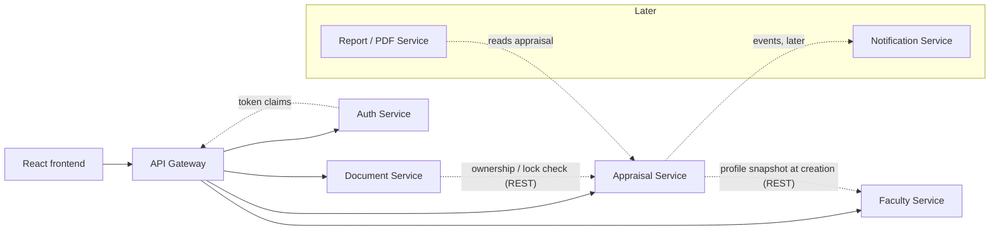

# Proposed Service Boundaries

> **PROPOSED.** Start small. A service exists because it owns a distinct set of data, security concern or change cadence, **not** because the PDF has many tables.

Related: [domain-model.md](domain-model.md) · [api-contract.md](api-contract.md) · [database-design.md](database-design.md)

## 1. Starting set

| Service | Responsibility | Owns (PostgreSQL schema) | Calls | Called by |
|---|---|---|---|---|
| **API Gateway** | Single entry point: routing under `/api/v1`, JWT verification, CORS, rate limiting, request-id and access logging. **No business logic** | none | all services | frontend |
| **Auth Service** | Sign-in, token issue/refresh, users and roles (`FACULTY`, `HOD`, `PRINCIPAL`; `ADMIN` is PROVISIONAL). Links a user to a faculty id | `auth` (users, roles, user_roles) | none | Gateway |
| **Faculty Service** | Faculty profile (identity, cadre, department) and the Department reference list | `faculty` (departments, faculty) | none | Appraisal, Gateway |
| **Appraisal Service** | The appraisal aggregate and everything in it: Part A snapshot, all repeating sections, "nothing to report" flags, the checklist ticks, declaration, **scoring (score sheet)**, HoD / Principal reviews, academic years, Annexure A reference data, activity trail, submission and locking | `appraisal` | Faculty (read profile when an appraisal is created) | Gateway, Document, Report |
| **Document Service** | Upload, validation, storage and download of supporting documents; metadata per appraisal and document type | `documents` + object/file storage | Appraisal (is this caller the owner, is the appraisal editable) | Gateway |

Endpoint ownership is in [api-contract.md §5](api-contract.md#5-endpoints).

## 2. Later services (do not build now)

| Service | When | Why separate |
|---|---|---|
| **Notification Service** | when reminders/emails or in-app notifications are needed | independent delivery channels and retry; consumes appraisal events (`AppraisalSubmitted`, …) |
| **Report / PDF Service** | when the college wants a generated report (the PDF form, filled) | CPU/format-heavy, independent scaling; reads an appraisal and renders |

Until then: `GET /notifications` and `GET /reports` can return empty lists (the frontend already handles that), or the Appraisal Service can serve them temporarily.

## 3. What is deliberately NOT a service

### No service per PDF section
Teaching, research, projects and the rest are rows of **one aggregate** that is read and saved together (autosave sends several sections in one request; the dashboard and submit need a consistent whole; one version number guards it). Splitting them would create distributed transactions, cross-service reads for a single screen, and ten deployables that change together. They are **packages/modules inside the Appraisal Service**.

### No separate Scoring Service (for now)
Scoring stays in the Appraisal Service because:
- a score is a function of **one appraisal's data plus its cadre**: there is nothing to share across services;
- score rows must stay **consistent with the appraisal in one transaction** (cadre snapshot, maximum marks copied at scoring time, lock on submit);
- the documents define **no scoring formula**: only maximum marks, at criterion level and, for B1 to B5, at component level. There is no rule engine to isolate yet.
- scoring **configuration** is versioned data (a scoring template assigned per academic year, with cadre maxima and components), so rule changes are new data rows in the Appraisal Service, not a new service.

Revisit only if a strong reason appears: scoring needs a different language/runtime, a different scaling profile, ownership by a different team, or the college introduces a rules engine shared with the "Faculty Performance Evaluation Form" appraisal panel that the PDF mentions.

### Review (HoD / Principal) stays in the Appraisal Service
They are children of the appraisal. A separate "Review/Workflow Service" would only make sense once the college defines a real multi-step approval workflow (PROVISIONAL today).

## 4. Rules for the services

1. **Database per service, schema isolation first.** One PostgreSQL cluster, one schema per service, each service with its own DB role that can touch only its schema. Splitting onto separate servers later needs no code change.
2. **No cross-service foreign keys or joins.** References are ids by value (`faculty_id`, `appraisal_id`). Denormalise what listing needs (the Document Service stores `academic_year`).
3. **Synchronous REST for reads that must be current; events for notifications.** Only two internal calls exist at the start (Appraisal → Faculty on creation; Document → Appraisal on upload/delete).
4. **The Gateway trusts nothing downstream trusts.** Services still check the token's roles and the resource owner; the Gateway is not the only line of defence.
5. **Reference data is seeded by migration** (departments, criteria, cadre maximum marks, document types) and exposed read-only.
6. **Stack-neutral.** The contract is HTTP + JSON + PostgreSQL. Any stack that can meet the contract is acceptable.
7. **Start as few deployables as is practical.** A single repository with four small services plus the gateway is the ceiling for phase 1. Faculty and Auth may share a deployable initially if the team prefers; the schema and API boundaries above still hold.

## 5. Cross-cutting requirements

| Concern | Requirement |
|---|---|
| Auth | JWT with `sub` (user id), roles; service-to-service calls use a service token |
| Authorisation | owner checks on every appraisal/document call; HoD/Principal scope is PROVISIONAL (own department) |
| Concurrency | `If-Match` on appraisal writes; `412` on stale |
| Errors | RFC 7807 problem+json everywhere |
| Observability | request id propagated; structured logs; health endpoints per service |
| Files | Document Service stores files outside the database (object or file storage), metadata in PostgreSQL, checksum recorded |
| Config | no secrets in the repo; `.env.example` only |
| Contract tests | the frontend's `dto.ts` and mapper conformance check is the baseline consumer test |
