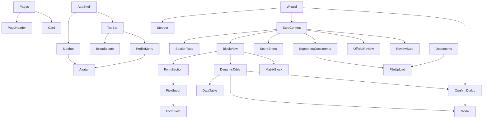

# Component Library

Each component exists once. Pages compose; they do not restyle. All styling uses tokens from `design-system.md`.

## Variants

### Card (`ui/Card`)
`default` · `flat` · `elevated` · `highlight` (the one primary card on a screen) · `interactive`. `pad`: `none` · `sm` · `md`.

### Button (`ui/Button`)
`primary` · `secondary` · `ghost` · `danger`, sizes `md` (38 px) and `sm` (32 px), `loading`. `IconButton` is square, needs a `label`, `tone="danger"` for delete.

### StatusBadge
`not_started`, `draft`, `in_progress`, `submitted`, `under_review`, `approved`, `returned`, `rejected`.

### Stepper markers
✓ completed · ● current · ○ upcoming · ! needs attention. Grouped by PDF part, with the PDF code (A, B1 …).

### Field types (`FieldInput`)
`text`, `textarea`, `number` (min / max / step), `date`, `month`, `select`, `combobox` (free text + suggestions), `daterange` ("Duration (From–To)", two keys), `checkbox`.

### Provisional marker (`ui/Provisional`)
`ProvisionalTag` (inline) and `ProvisionalNotice` (banner). Used wherever the PDF does not define the behaviour.

## Components

| Component | Location | Props (summary) | Notes |
|---|---|---|---|
| `AppShell`, `Sidebar`, `TopBar`, `ProfileMenu` | `layout/` | | See design-system |
| `Avatar`, `Breadcrumb`, `PageHeader`, `Card`, `Timeline`, `StatCard`, `ProgressRing` / `ProgressCard`, `StatusBadge` | `ui/` | | |
| `Modal` | `ui/` | `title`, `description?`, `footer`, `size` (`sm` / `md` / `lg`) | Focus trap, Esc, bottom sheet on mobile |
| `ConfirmDialog` | `ui/` | `title`, `message`, `tone`, `icon?`, `children?`, labels | Delete and submit |
| `EmptyState`, `LoadingSkeleton`, `TableSkeleton`, `ErrorState` | `ui/` | | |
| `ProvisionalTag`, `ProvisionalNotice` | `ui/` | `note` | |
| `FormSection` | `forms/` | `title`, `description?`, `badge?`, `columns` | Header-separated card |
| `FormField`, `controlCls` | `forms/` | `label`, `required`, `hint`, `error` | Shared control styling |
| `FieldInput` | `forms/` | `field`, `values`, `onChange(patch)`, `error` | Schema-driven control |
| `FileUpload`, `FileRow` | `forms/` | `files: UploadItem[]`, `onAdd`, `onRemove` | Compact drop zone; per-file state |
| `DataTable` | `tables/` | `columns` (`align?`), `rows`, `rowKey`, `actions?`, `serial?` | Table ≥ sm, stacked cards on phones; `serial` adds "S. No" |
| `DynamicTable` | `tables/` | `title`, `fields`, `rows`, `onChange`, `rowLabel` | Add/Edit/Duplicate/Delete; renders daterange / month / date cells |
| `Stepper` | `appraisal/` | `steps`, `current`, `states`, `base` | Grouped by part |
| `SectionTabs` | `appraisal/` | `tabs`, `active`, `onChange` | `tablist` with arrow-key navigation |
| `StepContent` | `appraisal/` | `step`, `ctx` | Renders a step by kind (sections / scores / official / review) |
| `BlockView` | `appraisal/` | `block`, `data`, `onBlock` | Fields / table / matrix + "nothing to report" |
| `MatrixBlock` | `appraisal/` | `block`, `values`, `onChange` | Research profile metrics |
| `ScoreSheet` | `appraisal/` | `scoreSheet`, `cadre`, `year` | **Display only**. Criterion rows with expandable B1 to B5 components; maxima from the API (or the printed `scoring.ts` copy), self-scores from the API; scoring-annexure and Annexure A reference viewers. No score is calculated |
| `ScoreCard` | `appraisal/` | `scores \| null` | Total self-score card for the dashboard |
| `SupportingDocuments` | `appraisal/` | `year`, `docs`, `enclosed`, `onEnclosed` | PDF checklist with per-item attach |
| `OfficialReview` | `appraisal/` | `kind`, `review` | Read-only HoD / Principal |
| `ReviewStep` | `appraisal/` | `states`, `issues`, `notAddressed` | Checklist and submit |

## Data and logic modules

| Module | Purpose |
|---|---|
| `data/appraisalSchema.ts` | The form, transcribed from the PDF: steps → sections → blocks → fields |
| `data/scoring.ts` | Nine criteria, five cadres, Annexure A maximum marks. No scoring formula |
| `data/supportingDocuments.ts` | The 11-item checklist |
| `lib/completion.ts` | UI-only completeness and input-sanity logic; submission gate (provisional) |
| `contract/dto.ts`, `contract/mapper.ts` | Wire types of the PROPOSED backend contract and the schema-driven form ↔ wire conversion |
| `lib/api.ts`, `lib/mockAdapter.ts` | Services calling the contract endpoints; mock backend returning the same DTOs |
| `lib/useDocuments.ts`, `lib/files.ts` | Upload state and file validation |

## Hooks / providers

`ThemeProvider` (`useTheme`), `ToastProvider` (`useToast`), `AppProvider` (`useApp`), `useAsync`, `useDocuments`.
