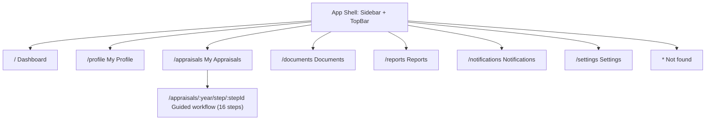
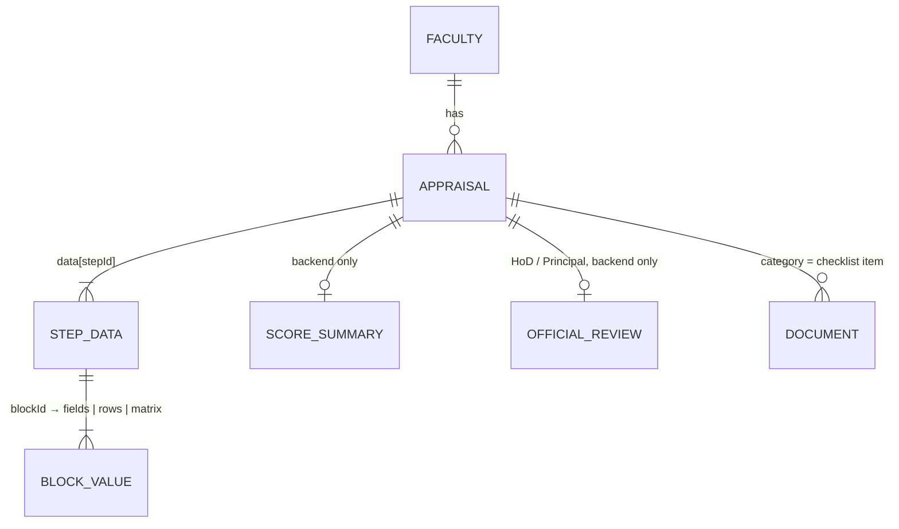

# Information Architecture

**Source of truth:** *Faculty Self-Appraisal & Assessment Report*, Sri Vasavi Engineering College (Autonomous), 6 pages (Part A, Part B sections 1–11, Declaration, HoD, Principal, Annexure A). Anything the PDF does not define is labelled **Provisional** in the UI and listed in [pdf-audit.md](pdf-audit.md).

## Sitemap

Sidebar order (fixed): Dashboard · My Profile · My Appraisals · Documents · Reports · Notifications · Settings.

## UI step → PDF section → PDF table / subsection

The PDF has Part A, eleven Part B sections, a Declaration and two official boxes. The UI has **16 steps**: one per PDF section, plus one UI-only step (Review & Submit). Sections that contain several tables are shown as tabs inside the step so every PDF table is a first-class screen without one giant page.

| # | UI step (id) | PDF location | PDF table / subsection → UI | Stepper code |
|---|---|---|---|---|
| 1 | General Information (`general`) | Part A | One form: Name of the Faculty, Academic Year, Employee ID, Contact No., Department / Branch (CE, ME, ECE / ECT, EEE, CSE / IT, AIML / CAI / DS, BSH, MBA), Designation (Cadre), Highest Qualification & Specialization, Ph.D. Status (Awarded / Pursuing / Not applicable), Date of Joining (Institution), Date of Joining (Present Designation), Total Experience (Years): Teaching / Industry / Research, E-mail ID, ORCID / Scopus / Google Scholar / Vidwan ID | A |
| 2 | Teaching & Learning (`teaching`) | Part B · 1 | **Courses handled during the Academic Year** table (S. No, Course Code & Name (Theory / Lab), Program & Branch, Sem, No. of Sections, Hours / Week, Pass %, Phase-1 Feedback %, Phase-2 Feedback %) + **Totals**: Total teaching load (Hrs/Week), Average Pass %, Average Feedback % (Ph-1 & Ph-2) | B1 |
| 3 | Student Mentoring, Project Guidance & Achievements (`mentoring`) | Part B · 2 | Tab **(a)**: Total No. of Students Mentored + **Student achievements** table (Student Name & Roll No., Achievement, Level, Month & Year). Tab **(b)**: **Student projects guided** table (Level Diploma/UG/PG, Project Title, No. of Students, Outcome) | B2 |
| 4 | FDPs / Certifications (`fdp`) | Part B · 3 | Tab **(a)** Workshops / FDPs / Seminars / Training programs attended (Title of the Program, Mode, Organizing Institution / Venue, Duration (From–To), No. of Days). Tab **(b)** Certifications (Platform, Title of the Course, Duration (From–To), No. of Weeks / Hours, Grade / Score) | B3 |
| 5 | Administrative Responsibilities (`admin`) | Part B · 4 | Three tabs: **(a)** Institute level roles, **(b)** Department level roles (Role, Responsibility / Description, Period; example roles from the PDF offered as suggestions), **(c)** Student workshops / events / tours / trainings / guest lectures organized / coordinated (Type of Activity, Role, Title / Details of the Event, Duration (From–To), No. of Beneficiaries) | B4 |
| 6 | Research & Publications (`research`) | Part B · 5 | Four tabs: **(a)** Journal publications: counts (SCI/SCIE, Scopus, UGC-CARE / ABDC, Others) + table (Title of Paper (mark your position in author list), Name of the Journal, Vol. / Issue / Page No., Month & Year, Indexing, DOI/ISSN). **(b)** Conference papers presented. **(c)** Research profile metrics (Google Scholar / Scopus / Web of Science × Total Publications / Total Citations / h-index / i10-index). **(d)** Research guidance: (i) scholars / PG dissertations guided table, (ii) Own Ph.D. progress (University / Center, Year of Registration, Current Stage, Progress during the year) | B5 |
| 7 | Funded Projects / Consultancy (`projects`) | Part B · 6 | Summary (Sanctioned, Applied, Total Amount Sanctioned (Rs.), Consultancy Revenue (Rs.)) + table (Title, Role (PI / Co-PI) & Team, Type, Funding Agency / Client, Amount (Rs.), Duration (From–To), Status, Year) | B6 |
| 8 | Patents, Books & IPR (`ipr`) | Part B · 7 | Tab **(a)** Patents / Designs / Copyrights: Filed / Published / Granted + table (Applicant / Inventor(s), Title & Application / Patent No., Type, Status, Date). Tab **(b)** Books / Book chapters: No. of Books Published, No. of Book Chapters Published + table (Authors, Title of the Book / Chapter, Publisher, ISBN, Month & Year, Type) | B7 |
| 9 | Outreach (`outreach`) | Part B · 8 | Table (Role*, Event / Activity, Name of the Organization / Institution, Venue, Date). The PDF's 11 example roles are suggested values | B8 |
| 10 | Professional Memberships, Awards & Recognitions (`memberships`) | Part B · 9 | Table (Membership / Award / Recognition, Professional / Awarding Body, Level, Year) | B9 |
| 11 | Any Other Contributions (`other`) | Part B · 10 | **Not a table.** Two free-text areas: At Department level, At Institute level | B10 |
| 12 | Self-Appraisal Score Sheet & Supporting Documents (`scores`) | Part B · 11 and Annexure A | **Score sheet** (S. No, Criteria, Max. Marks (my cadre), Self-Score, Total 100: 9 criteria, no 10th) with an **Annexure A** reference table; **Supporting documents enclosed** checklist (11 items, last is "Others: ____") | B11 |
| 13 | Declaration (`declaration`) | Declaration | PDF wording verbatim + Date, Place, Signature of Faculty | none |
| 14 | Recommendations of HoD (`hod`) | Recommendations of HoD | Read-only remarks + "Head of the Department (Signature with Seal & Date)" | none |
| 15 | Remarks of the Principal (`principal`) | Remarks of the Principal | Read-only remarks + "Principal (Signature with Seal & Date)" | none |
| 16 | Review & Submit (`review`) | **Not in the PDF** (UI step) | Checklist of every part + submit | none |

Stepper groups: **Part A**, **Part B**, **Declaration & approvals**, **Submission**.

### Not scored
"Any Other Contributions" has **no** row in the score sheet. There are exactly 9 scoring criteria totalling 100.

## Score configuration

`src/data/scoring.ts` holds the 9 criteria and the cadre-wise **maximum** marks printed in Annexure A (Lecturer, Assistant Professor, Senior Assistant Professor, Associate Professor, Professor; each totals 100, verified programmatically against the PDF). The PDF gives no formula for converting activity into a self-score, so none exists in the frontend. `selfScore` (total and optionally per criterion) is supplied by the backend and only displayed.

## Data model (frontend view)

- `data[stepId][blockId]` is either a field-values object, an array of rows, or (matrix) an object keyed `row.col`.
- `data[stepId]["<blockId>:none"] = { none: "true" }` records "nothing to report here".
- "Duration (From–To)" is stored as `<key>From` and `<key>To`.
- `data.scores.enclosed` stores the "Supporting documents enclosed" ticks and the "Others: ____" text.

## API surface expected by the UI

| Method | Path | Purpose |
|---|---|---|
| GET | `/profile` | Faculty identity (including `cadre`) |
| GET | `/dashboard?year=` | Status, completion, scores, pending sections, counts, activity |
| GET | `/appraisals` | List per year |
| GET | `/appraisals/:year` | `data`, `scores` (`maxScore`, `selfScore`, optional `criteria`), `reviews` (`hod`, `principal`) |
| PUT | `/appraisals/:year/draft` | Save `data` |
| POST | `/appraisals/:year/submit` | Submit |
| GET / POST / DELETE | `/documents` | Library; POST takes `category` (checklist item id) |
| GET | `/notifications`, `/reports` | |

With `VITE_USE_MOCK=true` a mock adapter answers locally. The paths are a proposal; adjust `src/lib/api.ts` to the real backend.
