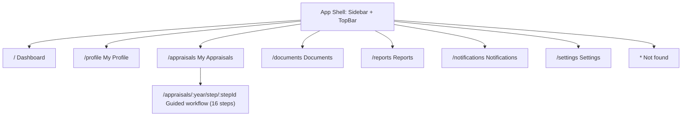
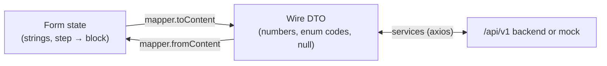

# Information Architecture

**Source of truth:** *Faculty Self-Appraisal & Assessment Report*, Sri Vasavi Engineering College (Autonomous), 6 pages (Part A, Part B sections 1–11, Declaration, HoD, Principal, Annexure A). Anything the PDF does not define is labelled **Provisional** in the UI and listed in [pdf-audit.md](pdf-audit.md).

**Backend contract (frozen, PROPOSED):** [../backend/api-contract.md](../backend/api-contract.md) · [domain-model.md](../backend/domain-model.md) · [service-boundaries.md](../backend/service-boundaries.md) · [database-design.md](../backend/database-design.md).

## Sitemap

Sidebar order (fixed): Dashboard · My Profile · My Appraisals · Documents · Reports · Notifications · Settings.

## UI step → PDF section → PDF table / subsection → contract section

The PDF has Part A, eleven Part B sections, a Declaration and two official boxes. The UI has **16 steps**: one per PDF section, plus one UI-only step (Review & Submit). The 16 steps are a **user-interface workflow**, not 16 database entities or services. Sections that contain several tables are shown as tabs inside the step so every PDF table is a first-class screen. The last column is the API section the step reads and writes.

| # | UI step (id) | PDF location | PDF table / subsection → UI | Stepper code | Contract section |
|---|---|---|---|---|---|
| 1 | General Information (`general`) | Part A | One form: Name of the Faculty, Academic Year (read-only), Employee ID, Contact No., Department / Branch (CE, ME, ECE / ECT, EEE, CSE / IT, AIML / CAI / DS, BSH, MBA), Designation (Cadre), Highest Qualification & Specialization, Ph.D. Status (Awarded / Pursuing / Not applicable), Date of Joining (Institution), Date of Joining (Present Designation), Total Experience (Years): Teaching / Industry / Research, E-mail ID, ORCID / Scopus / Google Scholar / Vidwan ID | A | `generalInfo` |
| 2 | Teaching & Learning (`teaching`) | Part B · 1 | **Courses handled during the Academic Year** table (S. No, Course Code & Name (Theory / Lab), Program & Branch, Sem, No. of Sections, Hours / Week, Pass %, Phase-1 Feedback %, Phase-2 Feedback %) + **Totals**: Total teaching load (Hrs/Week), Average Pass %, Average Feedback % (Ph-1 & Ph-2) | B1 | `teaching` |
| 3 | Student Mentoring, Project Guidance & Achievements (`mentoring`) | Part B · 2 | Tab **(a)**: Total No. of Students Mentored + **Student achievements** table (Student Name & Roll No., Achievement, Level, Month & Year). Tab **(b)**: **Student projects guided** table (Level Diploma/UG/PG, Project Title, No. of Students, Outcome) | B2 | `mentoring` |
| 4 | FDPs / Certifications (`fdp`) | Part B · 3 | Tab **(a)** Workshops / FDPs / Seminars / Training programs attended (Title of the Program, Mode, Organizing Institution / Venue, Duration (From–To), No. of Days). Tab **(b)** Certifications (Platform, Title of the Course, Duration (From–To), No. of Weeks / Hours, Grade / Score) | B3 | `fdp` |
| 5 | Administrative Responsibilities (`admin`) | Part B · 4 | Three tabs: **(a)** Institute level roles, **(b)** Department level roles (Role, Responsibility / Description, Period; example roles from the PDF offered as suggestions), **(c)** Student workshops / events / tours / trainings / guest lectures organized / coordinated (Type of Activity, Role, Title / Details of the Event, Duration (From–To), No. of Beneficiaries) | B4 | `administrative` |
| 6 | Research & Publications (`research`) | Part B · 5 | Four tabs: **(a)** Journal publications: counts (SCI/SCIE, Scopus, UGC-CARE / ABDC, Others) + table (Title of Paper (mark your position in author list), Name of the Journal, Vol. / Issue / Page No., Month & Year, Indexing, DOI/ISSN). **(b)** Conference papers presented. **(c)** Research profile metrics (Google Scholar / Scopus / Web of Science × Total Publications / Total Citations / h-index / i10-index). **(d)** Research guidance: (i) scholars / PG dissertations guided table, (ii) Own Ph.D. progress (University / Center, Year of Registration, Current Stage, Progress during the year) | B5 | `research` |
| 7 | Funded Projects / Consultancy (`projects`) | Part B · 6 | Summary (Sanctioned, Applied, Total Amount Sanctioned (Rs.), Consultancy Revenue (Rs.)) + table (Title, Role (PI / Co-PI) & Team, Type, Funding Agency / Client, Amount (Rs.), Duration (From–To), Status, Year) | B6 | `fundedProjects` |
| 8 | Patents, Books & IPR (`ipr`) | Part B · 7 | Tab **(a)** Patents / Designs / Copyrights: Filed / Published / Granted + table (Applicant / Inventor(s), Title & Application / Patent No., Type, Status, Date). Tab **(b)** Books / Book chapters: No. of Books Published, No. of Book Chapters Published + table (Authors, Title of the Book / Chapter, Publisher, ISBN, Month & Year, Type) | B7 | `ipr` |
| 9 | Outreach (`outreach`) | Part B · 8 | Table (Role*, Event / Activity, Name of the Organization / Institution, Venue, Date). The PDF's 11 example roles are suggested values | B8 | `outreach` |
| 10 | Professional Memberships, Awards & Recognitions (`memberships`) | Part B · 9 | Table (Membership / Award / Recognition, Professional / Awarding Body, Level, Year) | B9 | `membershipsAwards` |
| 11 | Any Other Contributions (`other`) | Part B · 10 | **Not a table.** Two free-text areas: At Department level, At Institute level | B10 | `otherContributions` |
| 12 | Self-Appraisal Score Sheet & Supporting Documents (`scores`) | Part B · 11 and Annexure A | **Score sheet** (S. No, Criteria, Max. Marks (my cadre), Self-Score, Total 100: 9 criteria, no 10th) with an expandable **component breakdown for B1 to B5** and **Annexure A** and scoring-annexure reference tables; **Supporting documents enclosed** checklist (11 items, last is "Others: ____") | B11 | `scoreSheet` (read-only), `supportingDocuments`, Documents API |
| 13 | Declaration (`declaration`) | Declaration | PDF wording verbatim + Date, Place, Signature of Faculty | none | `declaration` |
| 14 | Recommendations of HoD (`hod`) | Recommendations of HoD | Read-only remarks + "Head of the Department (Signature with Seal & Date)" | none | `reviews.hod` (read-only) |
| 15 | Remarks of the Principal (`principal`) | Remarks of the Principal | Read-only remarks + "Principal (Signature with Seal & Date)" | none | `reviews.principal` (read-only) |
| 16 | Review & Submit (`review`) | **Not in the PDF** (UI step) | Checklist of every part + submit | none | `POST /appraisals/{id}/submit` |

Stepper groups: **Part A**, **Part B**, **Declaration & approvals**, **Submission**.

### Not scored
"Any Other Contributions" has **no** row in the score sheet. There are exactly 9 scoring criteria totalling 100.

## Score configuration

`src/data/scoring.ts` holds the 9 criteria and the cadre-wise **maximum** marks printed in Annexure A (verified programmatically against the PDF: 45 values, each cadre totals 100). The PDF gives no formula for converting activity into a self-score, so none exists in the frontend. The backend is the source of truth for `maxScore` / `selfScore` (`ScoreSheetDto`); the frontend only displays them, and uses the printed maxima as reference until a score sheet exists.

## Scoring Annexure: B1 to B5

The score sheet now has two levels: **criterion** (maximum marks, Annexure A) and, for B1 to B5, **scoring components** (maximum marks per component, from the scoring annexure "Scoring criteria B1 to B5 (Annexure A & B)").

### CONFIRMED FROM SOURCE DOCUMENT
- B1 Teaching & Learning, B2 Student Mentoring, B3 FDPs / Certifications, B4 Administrative and B5 Research & Publications are divided into components with a maximum mark, **separately for each cadre**. Labels are verbatim; per cadre and criterion the components add up to the criterion maximum (25 pairs, 102 components; tables in [api-contract.md §3](../backend/api-contract.md#3-scoring-reference)).
- Components differ in number and wording by cadre, so they are shown only for the faculty member's own cadre (or the cadre chosen in the reference viewer) and never matched across cadres.
- B1 to B5 are the criteria whose Part B sections are steps B1 to B5 in the stepper (Teaching, Mentoring, FDPs, Administrative, Research).

### How the UI shows it (step B11, no redesign)
| Element | Behaviour |
|---|---|
| Criterion row | Unchanged columns: Criteria, Max. Marks (my cadre), Self-Score. Rows B1 to B5 gain a chevron |
| "Show component breakdown" | Expands every B1 to B5 row to list its components with `Max` and `Self-Score` (shown as "—" until the system supplies one). Each row can also be toggled alone (`aria-expanded`) |
| B6 to B9 rows | No chevron; a note says no component breakdown is defined (requires college confirmation) |
| Self-scores | Displayed only when the backend returns them. **No component score and no criterion total is calculated or summed by the frontend** |
| "Scoring annexure: components of B1 to B5" | Reference viewer with a cadre selector (defaults to the faculty member's cadre) listing every criterion with its components and maxima |
| Before a score sheet exists | The printed criterion and component maxima for the chosen cadre are shown, with "—" for self-scores |
| Methodology notice | While any breakdown is open, a note states that the college has not yet defined how component scores are produced and that a criterion's Self-Score is **not calculated from its components** |
| Footer | An amber Provisional tag lists what is not defined (how scores are produced, whether required, who enters them, sum rule, panel scores, granularity, B6 to B9) |

### REQUIRES COLLEGE CONFIRMATION
- **The scoring rules**: how evidence (pass %, feedback, publication counts, FDP counts, and so on) becomes a component score. Not defined, so no formula, threshold, weight or automatic scoring exists anywhere in the app.
- Who supplies component and criterion self-scores, and when; whether component self-scores are required.
- Whether a criterion self-score is the sum of its components (not implied anywhere in the UI).
- Whether panel scores use the same component breakdown, and the scoring granularity.
- **B6 Funded Projects / Consultancy, B7 Patents, Books & IPR, B8 Outreach, B9 Professional Memberships, Awards & Recognitions**: only the criterion maximum from Annexure A is defined; their detailed scoring methodology is undefined.

## Data flow (frozen contract)

- The schema (`src/data/appraisalSchema.ts`) is the single description of the form: every **block `id` is its path in the contract** (e.g. `teaching.entries`) and every **field `key` is the contract property** (e.g. `courseCodeName`); select values are **contract enum codes** (e.g. `INST`).
- `src/contract/dto.ts` declares the wire types; `src/contract/mapper.ts` converts between the all-strings form state and the wire shape (`'' → null`, numbers as numbers, `YYYY-MM-DD` / `YYYY-MM`, "Duration (From–To)" as `<key>From` / `<key>To`).
- Autosave sends only the **changed contract sections** with `PATCH /appraisals/{id}` and `If-Match: <version>`.
- Part A is prefilled by the backend from the faculty profile when the appraisal is created.
- "Nothing to report" is `nothingToReport: ["teaching.entries", …]`.
- The Supporting-documents ticks are `supportingDocuments.enclosed`; files go through the Document API with `documentType`.

## API surface

See [api-contract.md §5](../backend/api-contract.md#5-endpoints) (all **PROPOSED — REQUIRES BACKEND IMPLEMENTATION**). The frontend's `src/lib/api.ts` calls exactly those endpoints; with `VITE_USE_MOCK=true` (default in dev) a mock adapter implements them locally and stores/returns the same DTOs. Set `VITE_API_URL` and `VITE_USE_MOCK=false` to use a real backend.
