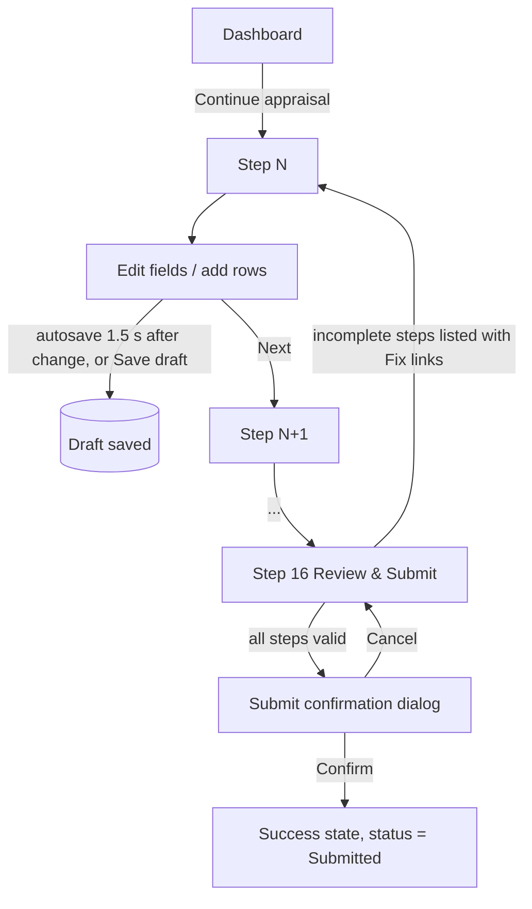
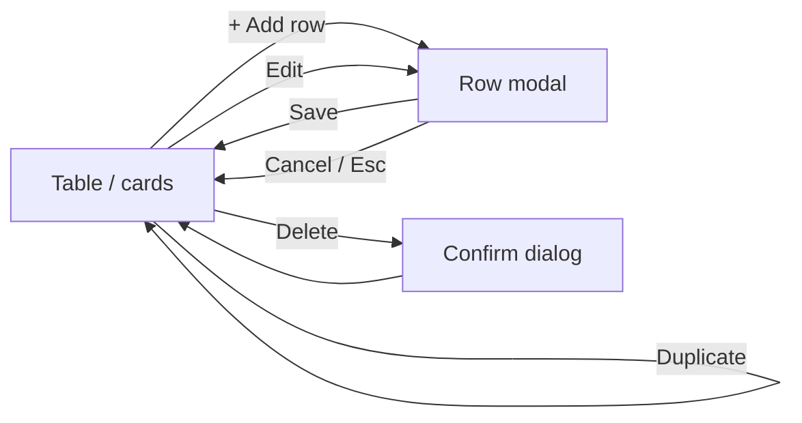

# User Flows

## 1. Complete and submit an appraisal (16 steps)

Save status indicator states: `Saved · 10:42`, `Saving…`, `Unsaved changes`, `Save failed — Retry`.

## 2. Repeating-row editing

Modal forms (not inline cells) are used because rows have many fields and must work on touch devices; short read-only summaries appear in the table.

## 3. Documents

Upload (drag-drop or browse) → type/size validation → listed with name, size, date → preview/download/delete (confirm).

## 4. Theme and sidebar

Theme toggle cycles light/dark and is remembered. Sidebar collapse is remembered. On mobile the sidebar is an off-canvas drawer opened from the top bar, closed by `Esc`, overlay click, or navigation.

## 5. Error and empty paths

| Situation | Behaviour |
|---|---|
| Initial load | Skeletons matching final layout |
| API failure | `ErrorState` with Retry |
| No rows / documents / notifications | `EmptyState` with primary action |
| Save fails | Persistent inline status + toast, local data retained |
| Unknown route | Not-found page with link home |
